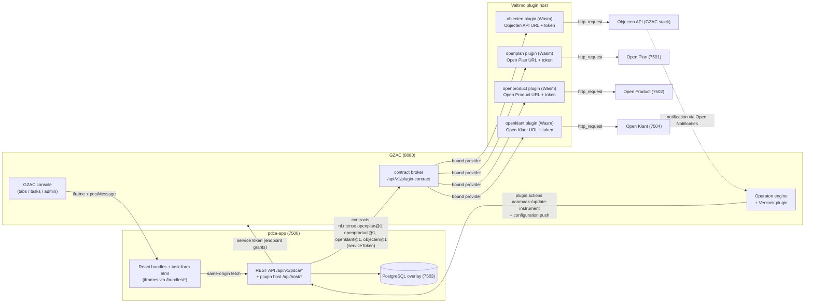
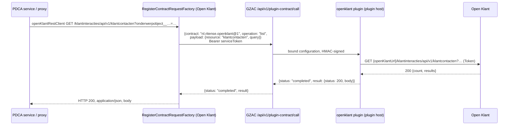
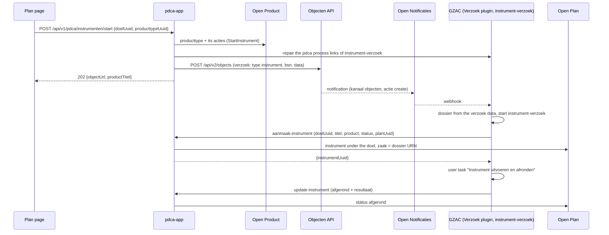

# PDCA app — Architecture & workings

**This document is the single source of truth for the design of the PDCA app.**
Every feature or behaviour change must update this document in the same change.
Setup and operating instructions live in
[`README.md`](./README.md); the GZAC configuration of the demo cases in
[`gzac/case-definitions/README.md`](./gzac/case-definitions/README.md).

## 1. What the app is

A standalone prototype for PDCA plan management (Plan-Do-Check-Act) that
connects two worlds:

- **Maykin's Common Ground registers** — [Open Plan](https://github.com/maykinmedia/open-plan)
  (plannen, doelen, instrumenten, personen),
  [Open Product](https://github.com/maykinmedia/open-product) (producttypen) and
  [Open Klant](https://github.com/maykinmedia/open-klant) (contactmomenten, as
  klantcontacten of the inwoner; §5.1) are the system of record for all plan
  data. The **Objecten API** carries the verzoeken by which a product is
  requested from a plan (§9).
- **Valtimo/GZAC** — the case management system in which the app runs as an
  *external plugin*: case tabs, task forms and an admin page as sandboxed
  iframes, and process execution (dossiers, tasks) through the GZAC API.
  GZAC also brokers the app's access to the registers: the app calls one
  contract per register (`nl.ritense.openplan@1`, `nl.ritense.openproduct@1`,
  `nl.ritense.openklant@1`, `nl.ritense.objecten@1`), each served by a
  register plugin (`plugins/<register>/`, on a plugin host) (§6.3).

The app itself is a single Spring Boot service (Kotlin, port 7500) with its own
PostgreSQL database for the **overlay**: only what the registers do not model.

## 2. System landscape

- The frontend **never** talks to the registers or GZAC directly: everything
  goes through the app's own backend (same-origin proxy, allowlists).
- **The registers are reached through GZAC.** The backend sends every
  register request as a call of that register's contract
  (`nl.ritense.<register>@1`); GZAC delivers it to the configuration of the
  register plugin the administrator bound, and that plugin, which holds the
  register's URL and token, calls the register (§6.3). This is the only
  route: the app holds no register URLs or credentials, so it always
  depends on GZAC and the four register plugins.
- GZAC talks to the app in both directions: it **fetches** the manifest and
  bundles, and it **pushes** plugin configurations (serviceToken, granted
  contracts) and plugin action calls to the app.

## 3. Design principles

1. **The registers are the source of truth.** The frontend consumes the
   register APIs in their *native* shape (Dutch camelCase, statuses
   `actief`/`afgerond`/`geannuleerd`, `{count, results}` pagination) through a
   thin same-origin proxy (`/openplan/...`, `/openproduct/...`,
   `/openklant/...`) that passes paths, bodies and status codes through
   unchanged. The proxy holds no credentials itself: it forwards through the
   backend's register clients, which go through the register contracts
   (§6.3). Contactmomenten
   are the one exception on the write side: the backend creates them,
   because one contactmoment spans several Open Klant resources (§5.1).
2. **The overlay is minimal** and keyed by register uuid. No copies of register
   data; only supplementary fields and links (see §5).
3. **Cross-register references are URNs**, e.g.
   `instrument.product = urn:pdca:openproduct:producttype:<code>` and
   `plan.domeinregister = urn:pdca:brp:persoon:<bsn>`.
4. **Plan = dossier, 1:1.** The link is a direct field in the overlay
   (`plan_details.dossier_id` = GZAC documentId, unique). The register field
   `plan.zaak` is not used.
5. **Configuration as code.** Case definitions live as importable zips in
   `gzac/`; environment-specific values (such as plugin configuration UUIDs
   and the objecttype URL of a verzoek) do **not** belong in a zip or a seed
   and are resolved at runtime or read from the registers (see §9).
6. **Self-provisioning startup.** Init containers seed reference data into the
   registers; Liquibase provisions the overlay; the app needs no manual data
   steps.

## 4. Backend layout (`src/main/kotlin/com/ritense/pdca/`)

| Package | Responsibility |
|---|---|
| `config/` | Spring configuration: properties, CORS, security, register clients, startup info |
| `domain/` | JPA entities of the overlay (§5) |
| `repository/` | Spring Data repositories |
| `service/` | Domain logic: `ActionService`, `IntakeService`, `DossierLinkService`, `PhaseConfigService`, `InstrumentAanvraagService` and `InstrumentActionService` (§9), `KlantcontactService` (§5.1), `GzacClient` |
| `web/rest/` | REST resources under `/api/v1/pdca/*` and `/api/v1/admin/*` |
| `plugin/` | The external-plugin host contract towards GZAC (§6): manifest, bundles, configuration push (`ConfigurationStore`, `PushedGzacAccess`), plugin actions |
| `registers/` | Same-origin proxy to Open Plan/Open Product/Open Klant, the register descriptions (`Register`, incl. the Objecten API), the contract transport (`RegisterContractRequestFactory`, §6.3) and display-only stubs (`/api/v1/registers/*`) for registers out of scope (BRP, objects) |

### API surface (outline)

| Resource | Path | Purpose |
|---|---|---|
| `PdcaResource` | `/api/v1/pdca/{plandetails,doeldetails,instrumentdetails,contactmomentdetails}`, `/api/v1/pdca/voortgangstatussen` | Overlay CRUD per register object; the voortgangsstatussen of a plan (§5.2) |
| `PdcaResource` | `POST /api/v1/pdca/contactmomenten`, `PATCH /api/v1/pdca/contactmomenten/{uuid}` | Create a contactmoment (took place or planned) and reschedule a planned one: the klantcontact in Open Klant plus its overlay row (§5.1); contactmomenten cannot be deleted |
| `ActieResource` | `/api/v1/pdca/acties` | Actions per doel |
| `InstrumentAanvraagResource` | `POST /api/v1/pdca/instrumenten/start` | Request a product for a doel: files the verzoek (§9) |
| `BetrokkeneResource` | `/api/v1/pdca/betrokkenen` (+ `PUT /{id}/procesbegeleider`) | Responsibilities/involved parties per plan and the plan's procesbegeleider (§5.2) |
| `EvaluatieResource` | `/api/v1/pdca/evaluaties?planUuid=` | Completed evaluations with their plan changes (§6.1); running ones are never listed here (the owner reads theirs through `/data`) |
| `DossierResource` | `/api/v1/pdca/dossiers/...`, `/plan-intake`, `/plans/{uuid}/dossier`, `/case-definitions` | Plan↔dossier link, prefill and creation routes (§7, §8) |
| `PhaseConfigResource` | `/api/v1/admin/phase-configs` | Case configuration per case definition (§10) |
| `RegisterProxyController` | `/openplan/**`, `/openproduct/**`, `/openklant/**` | Native register proxy through the register clients (via the register contracts, §6.3) |
| `PluginHostController` et al. | `/api/host/*`, `/bundles/*`, `/health`, `/plugins/{id}/{version}/...` | Plugin host contract (§6) |
| `PluginDataController` | `POST /plugins/pdca/{version}/data` | The contract's `/data` route: user-verified calls proxied by GZAC; evaluation sessions (§6.1) |

## 5. Overlay data model

All tables via Liquibase (`src/main/resources/config/liquibase/`:
`001-schema.xml` as the consolidated baseline, `002-seed-data.xml` for the
demo case configs, `003-subdoel-mapping.xml` for the subdoelmapping,
`004-drop-doelpositie.xml`, `005-plan-details-intake-dossier.xml`,
`006-evaluation-session.xml`, `007-evaluation-content.xml`,
`008-status-procesbegeleider-gepland-contactmoment.xml`,
`009-configureerbare-voortgangsstatussen.xml`,
`010-plugin-configuration-granted-contracts.xml` and
`011-drop-actie-bouwblokken.xml`; new changes continue the numbering). Core:

| Entity | Key | Holds |
|---|---|---|
| `PlanDetails` | `planUuid` | `dossierId` (1:1, unique), `intakeDossierId` (the intake this plan came from, §7), `caseDefinitionKey`, `persoonUuid`, plan display status, positie, subdoelgroep (W&P segmentation, advised by the intake DMN), hoofddoel type, `streefEinddatum` |
| `DoelDetails` | `doelUuid` | subdoelen and the hoofddoel: `UitvoeringsStatus` (GEPLAND or GESTART, §5.2), `voortgangStatus` (the code of one of the plan's voortgangsstatussen, §5.2) with its explanation `voortgangToelichting`, internal and external note, sort order (the hoofddoel's row has -1) |
| `InstrumentDetails` | `instrumentUuid` | `uitvoeringsStatus` (GEPLAND or GESTART, §5.2; null on an actief instrument means gestart), hours, effectiveness with its explanation (`effectiviteitToelichting`), internal and external note, abort reason |
| `ContactmomentDetails` | `contactmomentUuid` (= klantcontact uuid in Open Klant) | evaluation type, planned date (`geplandeDatum`), deelnemers, doelvoortgang (per subdoel the voortgangsstatus as recorded then: code, name and explanation; `evaluate` task form) and action points (intake and `evaluate` task form), `evaluationSessionId` when the contactmoment is a completed evaluation |
| `InvolvedParty` | own id | involved parties per plan; `isPrimary` marks the plan's **procesbegeleider** (at most one per plan, partial unique index; §5.2) |
| `Action` | own id | actions per doel, optionally attached to an instrument (`instrumentUuid`; W&P: instrument → 0..n taken, shown in the instrument block): title/description, `ActionStatus` (PLANNED → IN_PROGRESS → PENDING_REVIEW → COMPLETED/REJECTED), assignee, priority, dates and result |
| `PhaseConfig` | `caseDefinitionKey` | case configuration (§10) |
| `StoredPluginConfiguration` | `configId` | plugin configurations pushed by GZAC: serviceToken, gzacBaseUrl, title, properties, event subscriptions, `grantedContracts` (the contracts GZAC bound, §6.3) |
| `EvaluationSession` | own id | an evaluation a user runs on a plan (§6.1): `dossierId`, `planUuid`, `caseDefinitionKey`, owner `userLogin`, `EvaluationSessionStatus` (RUNNING → COMPLETED or CANCELLED), start/end time, the contactmoment fields (`evaluatieType`, `deelnemers`, `verslag`), the planned contactmoment it carries out (`geplandContactmomentUuid`) and, once completed, `contactmomentUuid`; at most one RUNNING per user (partial unique index) |
| `EvaluationChange` | own id | one plan change recorded in a session (§6.1): `subjectType` (PLAN, HOOFDDOEL, SUBDOEL, INSTRUMENT, ACTIE) + `subjectUuid` + `subjectTitel`, `soort`, `vanWaarde`/`naarWaarde` (display values), `toelichting` (the reason given in the evaluation) |

### 5.1 Contactmomenten in Open Klant

A contactmoment of a plan is a **klantcontact** in Open Klant
(Klantinteracties API), so it is part of the inwoner's klantbeeld alongside
the contacts other systems record. The overlay row `ContactmomentDetails`
(keyed by the klantcontact uuid) keeps the PDCA side: type, deelnemers,
doelvoortgang, actiepunten and the evaluation it came from.

- **Writing** goes through the backend (`KlantcontactService`): one
  `POST /maak-klantcontact` creates
  - the klantcontact — kanaal `gesprek`, onderwerp `<type>: <plan titel>`,
    the verslag as `inhoud` (Open Klant allows at most 1000 characters; the
    side panel counts down, the backend rejects longer text with 400),
    `vertrouwelijk` true, `taal` `nld`, `plaatsgevondenOp` the moment of the
    conversation (an evaluation's start);
  - an onderwerpobject pointing at the plan: `codeRegister` `open-plan`,
    `codeObjecttype` `plan`, `codeSoortObjectId` `uuid`, `objectId` the plan
    uuid;
  - for a plan about a person (`plan.domeinregister` =
    `urn:pdca:brp:persoon:<bsn>`), the inwoner as betrokkene (rol `klant`):
    the partij with that BSN, created with only its identificator
    (`natuurlijk_persoon` / `bsn` / `brp`) when Open Klant does not know it
    yet — the name stays in the BRP. Object plans get no betrokkene.

  Routes that create a contactmoment: completing an evaluation (§6.1), the
  intake (`POST /plan-intake`, §8; its "Geplande evaluaties"), planning an
  evaluation on the Evaluaties tab or after completing one in the side panel,
  and the `evaluate` task form (all three via
  `POST /api/v1/pdca/contactmomenten`, `afgerond` false for a planned one).
- **Planned evaluations** — a planned contactmoment is a klantcontact with
  `indicatieContactGelukt` null whose `plaatsgevondenOp` is the planned
  moment (12:00 on the planned date; the overlay keeps `geplandeDatum`).
  `PATCH /api/v1/pdca/contactmomenten/{uuid}` with `{datum}` reschedules it
  (409 once it took place). It is carried out by an evaluation session
  (§6.1): completing that session records *this* klantcontact as having
  taken place (indicatieContactGelukt true, the verslag as inhoud, the
  session's start as `plaatsgevondenOp`) instead of creating a new one.
- **No deleting** — a contactmoment is a record of a conversation in the
  inwoner's klantbeeld; the app offers no way to delete one.
- **Status** — a klantcontact has no status; one that took place has
  `indicatieContactGelukt` true (*Afgerond*), a planned one has null
  (*Gepland*, or *Verlopen* once its date has passed); false shows as *Niet
  gelukt*.
- **Reading** is native, through the proxy:
  `/openklant/klantinteracties/api/v1/klantcontacten` filtered on the
  plan's onderwerpobject (`onderwerpobject__onderwerpobjectidentificator…`).
  The Planoverzicht (KPI "Volgende evaluatie" and recent evaluaties) and the
  Evaluaties tab read it this way.

### 5.2 Statuses and procesbegeleider

One lifecycle, with the same words everywhere (`labels.ts`: `doelStatus`,
`instrumentStatus`, `actieStatus`, `planStatus`, `contactmomentStatus`):

| Object | Gepland | Gestart | Afgerond | Afgebroken |
|---|---|---|---|---|
| Subdoel | register `actief` + overlay GEPLAND | `actief` + GESTART | `afgerond` (resultaat `gefaald`: *Niet behaald*) | `geannuleerd` |
| Hoofddoel | `actief` + overlay GEPLAND | `actief` otherwise | `afgerond` | `geannuleerd` |
| Instrument | `actief` + overlay GEPLAND | `actief` otherwise (also without overlay row) | `afgerond` | `geannuleerd` |
| Actie | PLANNED | IN_PROGRESS | COMPLETED | — (plus *Ter beoordeling* PENDING_REVIEW and *Afgekeurd* REJECTED) |
| Plan | — (the configured display status while `actief`) | — | `afgerond` | `geannuleerd` |

- Starting or completing an instrument under a *Gepland* subdoel starts that
  subdoel too, so a subdoel never looks unstarted while work under it runs.
- The intake and the create-plan form use the row values `gepland` /
  `gestart` / `afgerond` for subdoelen and instrumenten; `POST /plan-intake`
  maps them onto register status + overlay, gives every instrument an
  overlay row, starts a subdoel whose instrument is gestart or afgerond, and
  gives the hoofddoel a GESTART row. Legacy `actief` still works (doel:
  gepland; instrument: gestart).
- A plan is closed with *Plan afronden* (optional explanation) or *Plan
  afbreken* (reason required), both stored in Open Plan's `redenEinde`.

**Voortgangsstatus** — next to its lifecycle, a running hoofddoel or subdoel
says how it is going. There is no percentage; the statuses are configured
per plan case type (`PhaseConfig.voortgangStatussen`, §10) and the same list
applies to the hoofddoel and the subdoelen.

- **A status** is `{code, naam, betekenis}`: the `code` is stable and stored
  on the doel (`DoelDetails.voortgangStatus`), the `naam` is what users see
  and can be renamed, the `betekenis` (`GAAT_GOED`, `LET_OP`,
  `GAAT_NIET_GOED`) gives the tag colour (green, magenta, red) and counts in
  the Voortgang KPI (§6.2). The backend assigns the code of a new status once,
  from its name (`Wacht op inwoner` → `WACHT_OP_INWONER`).
- **Standard list** — a case type that configures none gets *Op koers*
  (gaat goed), *Aandacht nodig* (let op) and *Loopt achter* (gaat niet goed)
  (`VoortgangStatusOptie.STANDAARD`). `GET /api/v1/pdca/voortgangstatussen
  ?planUuid=` gives the list of a plan's case type, without plan the standard
  list; the plan tabs and the `evaluate` task form read it there, PDCA
  Beheer the standard list.
- **The register decides the phase.** A voortgangsstatus can only be set
  while the doel is `actief` in Open Plan: `PUT /doeldetails/{uuid}` with a
  changed `voortgangStatus` checks the doel in Open Plan (409 otherwise) and
  that the code is in the plan's list (400 otherwise). Afronden and Afbreken
  stay explicit actions that write to the register; a voortgangsstatus never
  does. Once a doel is closed, its card shows the register status (*Afgerond*,
  *Niet behaald*, *Afgebroken*) and no voortgang; the value stays in the
  overlay and in the evaluation history and shows again when the doel runs
  again.
- **No double meanings** — a voortgangsstatus may not be named like a
  lifecycle status (*Gepland, Gestart, Afgerond, Afgebroken, Behaald, Niet
  behaald*); names are unique per list.
- **Removed statuses** — a doel whose status was removed from the list keeps
  showing it, in gray (its name from the code, or as recorded), and can keep
  it until someone picks another one; it counts as assessed but neither
  *gaat goed* nor *let op* in the KPI.

The **procesbegeleider** is one concept: the betrokkene with `isPrimary`
(label "Procesbegeleider" everywhere; the intake rows carry
`procesbegeleider`, older documents' `hoofdverantwoordelijke` is still
read). A plan has at most one. `BetrokkeneService` makes a betrokkene the
procesbegeleider on create (`isPrimary` true) or via
`PUT /api/v1/pdca/betrokkenen/{id}/procesbegeleider`, unsetting the previous
one, and writes it to Open Plan as `plan.medewerker`
(`urn:pdca:medewerkers:medewerker:<name, dots/spaces as single dots,
lowercase>`, empty when there is none) in the same transaction — a refusal
by Open Plan rolls the change back. The plan intake sets `medewerker` the
same way.

## 6. GZAC integration: the external-plugin host contract

The app implements the Valtimo **"URL app" contract** (`plugin/`):

- **Discovery** — `GET /api/host/plugins` returns the manifest: plugin `pdca`
  ("PDCA Planbeheer"), version, configuration schema, capabilities, granted
  endpoints, the contracts it calls (`permissions.contracts`:
  `nl.ritense.openplan@1`, `nl.ritense.openproduct@1`, `nl.ritense.openklant@1`
  and `nl.ritense.objecten@1`, §6.3), views and actions. GZAC discovers the
  app by URL registration.
- **Views** — 3 case tabs (`plan-overview`, `plan-goals`, `plan-evaluations`),
  1 admin page (`pdca-admin`), 3 task forms (`create-plan`, `update-goals`,
  `evaluate`) and 1 side panel (`evaluation`, §6.1). Each view is an html
  bundle under `/bundles/*` that GZAC loads as a sandboxed iframe.
- **Configuration push** — when a plugin configuration is created/saved (and
  on every discovery poll), GZAC pushes `configId` + `serviceToken` +
  `gzacBaseUrl` + `grantedContracts` to
  `POST /api/host/configurations/{configId}`; the app persists this
  (`StoredPluginConfiguration`) so restarts need no re-linking.
  `grantedContracts` lists the contracts the administrator bound to a
  provider; the app uses it to tell "register not bound" from "GZAC
  unreachable" (§6.3).
- **Capability `frontend_data` + the `/data` route** — `POST
  /plugins/pdca/{version}/data` (`PluginDataController`) serves the iframe
  calls GZAC proxies with the user's downscoped token (bridge
  `pluginData`). The app verifies that token against GZAC's introspection
  endpoint (`GzacClient.introspectUserToken`) and gets the user's login back;
  this is the only place the app knows **who** the user is, so everything
  user-bound goes through it. It fails closed (GZAC unreachable = 503). The
  `context` in the request comes from the GZAC frontend but is not trusted:
  dossier access is checked as the user (`GET /api/v1/document/{id}` with the
  user token, so GZAC applies PBAC).
- **Capability `gzac_api` + endpoint grants** — the manifest declares exactly
  which GZAC endpoints the app calls with the serviceToken (allowlist; PBAC is
  bypassed for granted endpoints). Currently: create dossier
  (`new-document-and-start-process`), read document definitions and
  documents (plus case inspection for the content, see below), read the
  latest process definition and the process links of the instrument dossier
  and repair its plugin configuration (plugin-configuration-mappings, §9).
  The full list with rationale lives in one place:
  `PluginHostController.GRANTED_ENDPOINTS`.
- **Plugin actions** — GZAC processes call back into the app via
  `POST /plugins/{pluginId}/{version}/actions/{actionKey}`
  (`PluginActionController`): `aanmaak-instrument` and `update-instrument`,
  with which the instrument dossier manages the instrument in Open Plan
  (§9). The call carries the dossier (`documentId`) it comes from; an action
  response can return declared outputs through the contract's `result`
  channel — this is how `aanmaak-instrument` hands the new `instrumentUuid`
  back to the process.
- **Credential order** of `GzacClient` towards GZAC: (1) pushed serviceToken +
  gzacBaseUrl (`PushedGzacAccess`, the most recently pushed configuration),
  (2) `pdca.gzac.static-token`, (3) Keycloak client-credentials fallback. The
  pushed gzacBaseUrl is the host's server-to-server callback URL entered in
  GZAC; `GZAC_URL` (no default) only overrides it where the app sees GZAC
  under a different address (the compose container via
  `host.docker.internal`), and is required for options (2) and (3). Contract
  calls (§6.3) only use option (1): GZAC resolves the binding from the
  calling configuration, which a static or Keycloak token does not identify.
- **Reading dossier content** — GZAC serializes a document's `content` on
  `GET /api/v1/document/{id}` only when it runs with
  `valtimo.includeDocumentContentInResponse: true` (default off; the local
  dev GZAC has it on). Without it `GzacClient.getDocument` reads the content
  from the case inspection endpoint (`GET /api/management/v1/case/{id}`),
  which always includes it. If neither yields content the call fails with
  an explicit message instead of returning a document without content —
  otherwise the prefill would silently come back empty.
- **Create-plan prefill failure** — when `plan-prefill` fails (GZAC
  unreachable, the token refused, or the content not delivered), the
  create-plan form stays usable but shows the backend's error message
  instead of an unexplained empty form.

The iframe↔host communication (passing the documentId, completing a task,
navigation, `/data` calls, side-panel offers) uses the
`valtimo-plugin`/`valtimo-host` postMessage protocol in
`frontend/src/shared/bridge.ts`:

- **Completing a task** — `submitTask(data)` posts the task-form data with a
  correlation id; GZAC submits it as the user and answers with
  `submitResult` (errors are shown in the form). On success GZAC closes the
  task modal and removes the iframe at once.
- **Navigation** — `navigateHost(route)` posts the plugin SDK's `navigate`
  event (e.g. to `/cases/<caseDefinitionKey>/document/<documentId>`). The
  SDK marks it *reserved*: current GZAC frontends do not act on it yet, and
  the iframe sandbox (`allow-scripts allow-forms`) blocks navigating the
  page any other way. The app sends it where a jump belongs (after
  create-plan, §7; the Dossier button of an instrument, §9), so the jumps
  work once the host handles the event.
- The sandbox has no `allow-modals` either, so the bundles never use
  `window.confirm`/`alert`; confirmations are Carbon modals.

### 6.1 Evaluations in GZAC's side panel

GZAC has an app-wide side panel next to the page content that survives
navigation. It knows nothing about evaluations: a plugin surface *offers*
content (`offerPanel`), the latest offer takes the panel over, re-offering the
same key only shows it again, and closing the panel only hides it. The app
offers its `side-panel` bundle `evaluation` (`evaluation-panel.html`), keyed
by the session id. Everything about the evaluation itself lives here.

**What an evaluation is.** The set of changes made to the plan while the
evaluation runs, plus the contactmoment information: type (one of the case
type's evaluation types; EVALUATION when offered), deelnemers and the
gespreksverslag (how the inwoner is doing, what was discussed, why the plan
changes). Changes are made where they are always made — in the Planoverzicht
and Doelen & Acties tabs — and take effect immediately, like any other plan
edit: an evaluation is not a transaction and cannot be rolled back. The side
panel shows a summary of those changes, refreshed every few seconds, and holds the contactmoment
fields.

- **Session = user + plan.** `EvaluationSession` records the owner (verified
  login, §6), the dossier and the plan. A running session, its contactmoment
  fields and its changes are only reachable through the `/data` route and
  only for the owner; colleagues see an evaluation once it is completed.
- **One running session per user.** Starting a second one returns 409 with
  the running session; the Evaluaties tab then says to finish that one first.
- **Start** — "Start evaluatie" on the Evaluaties tab starts a session
  (`POST /evaluation-sessions`, dossier from the tab's GZAC context) and
  offers the panel. A planned evaluation's "Starten" passes its uuid
  (`{geplandContactmomentUuid}`): the session then carries out that planned
  contactmoment (§5.1) and takes over its type. Without one, the session
  carries out the plan's earliest planned contactmoment that is due (today
  or earlier) and not already taken by another running session; without a
  due one it carries out none. The panel names the planned evaluation it
  carries out.
- **Back on the plan** — every plan tab calls `syncEvaluationPanel` on load:
  when the user's running session belongs to this dossier, the panel is
  offered again, so it reappears after it was closed or after a page reload.
  Elsewhere in GZAC the panel only stays while it is open in that browser tab.
  While the session is on this plan, the Planoverzicht and Doelen & Acties
  tabs show an "Evaluatie loopt" banner.
- **Recording changes** — after every successful plan change the tab calls
  `recordEvaluationChange` (`POST /evaluation-sessions/current/changes`).
  Without a running session on this plan this is a no-op; a failure to record
  never blocks or undoes the change. Each change carries the onderdeel
  (`subjectType` + uuid + title), its `soort` (e.g. `SUBDOEL_TOEGEVOEGD`,
  `VOORTGANG`, `INTERNE_NOTITIE`, `INSTRUMENT_AFGEBROKEN`,
  `HOOFDDOEL_GEWISSELD`, `POSITIE`; labels in `labels.ts`) and display values
  `vanWaarde`/`naarWaarde`. Value changes are sent with `samenvoegen`: a later
  change of the same kind on the same onderdeel updates the earlier one's
  `naarWaarde`, and a value changed back to where it started drops out. A
  change can carry the reason entered with it in the tab (`toelichting`): the
  explanation of a voortgang or of an instrument's hours/effectiveness, sent
  only when that explanation itself changed. It becomes (or replaces) the
  change's reason, and keeps a change whose value did not move — "still
  *Loopt achter*, because …" — in the evaluation. The backend rejects a
  change for another plan than the session's (409).
- **Panel and tabs stay in sync through the backend.** GZAC sandboxes every
  bundle iframe at its own opaque origin (no `allow-same-origin`), so the
  panel and the tabs cannot message each other. The panel polls its changes
  every 3 seconds while the session runs; a tab that knows a running session
  polls `/evaluation-sessions/current` at the same interval and, once the
  session is gone (completed or cancelled in the panel), drops the banner
  and — on the Evaluaties tab — reloads the list. A change rejected with 404/409 ends the
  session in that tab as well.
- **The panel** shows plan and start time, the contactmoment fields (saved
  automatically, `POST /evaluation-sessions/current/draft`) and the changes
  grouped per onderdeel, each with an optional reason
  (`/evaluation-sessions/current/change-toelichting`, prefilled with the
  explanation entered in the tab) — e.g. why an instrument stops, which may
  matter for subsidies. Note changes get no reason field: a note is its own
  explanation.
- **End** — only explicitly, by completing or cancelling. Closing the panel
  only hides it.
  - "Evaluatie afronden" needs a gespreksverslag and asks for confirmation;
    it first writes any pending draft (a failed save blocks completing, so
    the latest verslag is always the one recorded).
    `POST /evaluation-sessions/current/complete` records the contactmoment
    that took place at the session's start with the verslag as inhoud: the
    planned klantcontact the session carries out, or a new one (§5.1). Its
    `ContactmomentDetails` row gets type, deelnemers and
    `evaluationSessionId`; the session becomes COMPLETED. The gespreksverslag
    is limited to 1000 characters for that reason. A failure is shown next
    to the buttons and leaves the evaluation running. After completing, the
    panel offers "Volgende evaluatie plannen" (date, default six weeks
    ahead, and type), which creates the next planned contactmoment.
  - "Evaluatie annuleren" asks for confirmation;
    `POST /evaluation-sessions/current/cancel` marks the session CANCELLED.
    Nothing is written to Open Klant, a planned contactmoment it carried out
    stays planned, and the recorded changes stay with the cancelled session,
    which is never shown. The plan changes made during it stay: they were
    made in the registers already.
- **Calls through the host** (`pluginData`) resolve with status 0 when GZAC
  does not answer within 30 seconds, so the panel never waits forever.
- **Evaluaties tab** — the toolbar has "Evaluatie plannen" (date, type,
  optional agenda) and "Start evaluatie" / "Toon lopende evaluatie". The
  user's own running evaluation of this plan is shown on top (tag *Loopt*,
  start time, deelnemers, the concept verslag and the changes so far,
  refreshed on opening; only its owner sees it). When it carries out a
  planned contactmoment, that contactmoment is shown only as the running
  evaluation (with its planned date and agenda) and not counted as planned.
  Then follow the planned evaluations (*Gepland* or *Verlopen*, with
  "Starten" and "Verzetten") and the contactmomenten that took place; a completed evaluation shows who ran
  it, the deelnemers, the gespreksverslag and its plan changes with their
  reasons (`GET /api/v1/pdca/evaluaties`). Contactmomenten from the intake or
  the `evaluate` task form show their notitie, doelvoortgang (the
  voortgangsstatus per subdoel as recorded then) and actiepunten. A type filter (content switcher)
  narrows the list.
- The panel fills the full panel height and follows GZAC's light/dark theme
  (the `theme` in `init` plus `themeChanged`, bridge `onHostThemeChanged`),
  on the same `--cds-layer` surface as GZAC's panel and menu; its content is
  a Carbon `Layer` on that surface (§11).
- The "Evaluatie loopt" banner spans the full tab width, like the other
  page-level notifications (`pdca-notification`).

### 6.2 Voortgang and notes in the plan tabs

- **Voortgang per subdoel and of the hoofddoel** — an active subdoel and the
  active hoofddoel (expand its card) get one of the plan's voortgangsstatussen
  (§5.2; `DoelDetails.voortgangStatus`) with an explanation
  (`voortgangToelichting`), shown as a tag in the card header. A closed doel
  shows no voortgang.
- **Voortgang per instrument** — hours spent, effectiveness (1–5) and an
  explanation (`InstrumentDetails.effectiviteitToelichting`).
- **Internal and external note** on every subdoel, on the active hoofddoel
  and on every instrument: internal is for colleagues only, external may be
  shared with the inwoner (`DoelDetails` resp. `InstrumentDetails`).
- **Read first, edit on request** — a card shows "Voortgang & notities" as a
  compact summary (status tag and explanation, or *Nog niet beoordeeld*; the
  first line of each note, or *Geen notities*) with "Bijwerken", which opens
  one form for voortgang and notes; it saves only what changed and closes
  after saving or "Annuleren". An instrument opens the same pattern from its
  menu, scrolled into view. In a subdoel card the order is: description,
  actions, Acties, Instrumenten, Voortgang & notities; the collapsed header
  shows the status, the voortgang and a count of acties and instrumenten.
- **Actions and confirmations** — a subdoel has one state button (Starten /
  Afronden) and an overflow menu (Bewerken, Afbreken, Verwijderen); an
  instrument has its state button and a menu (Actie toevoegen, Voortgang &
  notities, Afbreken). Afbreken asks for a reason; Verwijderen and removing a
  betrokkene ask for confirmation in a danger modal that says what goes with
  it. The plan header shows the status tag and a "Planacties" menu (the
  configured display statuses, Plan afronden, Plan afbreken; Plan
  heractiveren for a closed plan). The "Instrument aanvragen" menu only
  appears when the subdoel has requestable producttypen (§9). Modals block
  a second submit while saving (`useSubmit`).
- **Planoverzicht KPIs** — *Voortgang*: active subdoelen whose status *gaat
  goed* out of those assessed, with the number whose status means *let op*
  or *gaat niet goed* (needs attention) and the number not yet assessed (*Nog niet beoordeeld* while none is); *Subdoelen*: running
  out of all subdoelen (hoofddoel excluded); *Open acties*; *Volgende
  evaluatie*: the earliest planned evaluation (marked *verlopen* when
  overdue) or *Niet gepland*, with the number completed.
- During an evaluation, the explanation of a voortgang becomes the reason of
  the recorded change (§6.1).

### 6.3 The registers through their contracts

The app holds no register URL or token and has no other way to reach a
register than its contract. Each register has its own contract and its own
external plugin, all four built the same way from `plugins/<register>/`:

| Register | Contract | Plugin | API the contract covers | Resources |
|---|---|---|---|---|
| Open Plan | `nl.ritense.openplan@1` | `openplan` | `/plannen/api/v0` | `plan`, `doel`, `instrument`, `persoon`, `doeltype`, `instrumenttype`, `relatietype`, `plantype`, `overkoepelendplan` |
| Open Product | `nl.ritense.openproduct@1` | `openproduct` | `/producttypen/api/v1` | `producttypen`, `themas`, `prijzen`, `links`, `acties`, `content`, `contentlabels`, `schemas` |
| Open Klant | `nl.ritense.openklant@1` | `openklant` | `/klantinteracties/api/v1` | `klantcontacten`, `maak-klantcontact`, `betrokkenen`, `onderwerpobjecten`, `bijlagen`, `partijen`, `partij-identificatoren`, `vertegenwoordigingen`, `actoren`, `actorklantcontacten`, `internetaken`, `digitaleadressen`, `rekeningnummers`, `categorieen`, `categorie-relaties` |
| Objecten API | `nl.ritense.objecten@1` | `objecten` | `/api/v2` | `objects` (the verzoeken, §9; backend only, no proxy prefix) |

The app declares the four contracts under `permissions.contracts` in its
manifest, and GZAC's contract broker forwards each call to the configuration
the administrator bound to that contract: a configuration of the register's
plugin, a Wasm plugin on a Valtimo plugin host that holds the register URL
(`openPlanUrl`, `openProductUrl`, `openKlantUrl`; an egress target) and the
secret API token (`openPlanToken`, …) and makes the actual HTTP request. The
app never learns which plugin or host serves a contract. The registers are
described once, in the `Register` enum (contract, API path, proxy prefix and
property key).

- **Binding** — the administrator binds each contract when activating the
  PDCA configuration in GZAC (*Required plugins*; preselected when exactly
  one configuration of the providing plugin exists) or later in its edit
  screen. GZAC then pushes the bound contracts as `grantedContracts`. The
  binding is checked per register: an unbound Open Klant does not affect
  Open Plan. The manifest keeps version `0.2.0` when its footprint changes:
  GZAC pins a hash of the manifest, so an in-place change waits for the
  administrator to review and accept it, after which the existing
  configuration, tabs and links keep working and GZAC binds a newly declared
  contract itself if exactly one provider exists.
- **One transport per register** — every service and the proxy use the
  register's RestClient bean (`openPlanRestClient`, `openProductRestClient`,
  `openKlantRestClient`, `objectenRestClient`). That client has the placeholder
  base URL `http://<register>.contract` and a `RegisterContractRequestFactory`
  for that register as its request factory, so callers keep writing ordinary
  register API requests.
- **Request → operation** — only path and query count, so absolute URLs
  (the registers' `next` links) map the same way: `<api path>/<resource>`
  with GET is `list`, `/<resource>/<uuid>` with GET is `get`, POST on the
  collection is `create` (also `maak-klantcontact`, Open Klant's endpoint
  that creates a klantcontact with its onderwerpobject and betrokkene in one
  request), PATCH on an object `update`, PUT on an object `update` with
  `replace: true`, DELETE on an object `delete`. The payload is
  `{resource, uuid?, query?, body?, replace?}`; the query string becomes the
  `query` map. Any other shape (deeper paths, POST on an object, other
  methods or another register's API) is answered locally with 400 "wordt
  niet ondersteund via het <register>-contract". Each plugin accepts only
  the resources in the table above; bodies are JSON, so Open Product's file
  uploads (`bestanden`) are not part of its contract.
- **Responses are reproduced** — the plugin answers `{status, body}` with
  the register's own status and JSON body, also for 4xx/5xx, and the factory
  turns that back into an HTTP response with that status and
  `application/json`. Validation errors (`invalidParams`) and 404s therefore
  reach the services and the frontend exactly as from the register API itself;
  `next` links point at the address the plugin uses and only serve as "more
  pages" markers (the app pages with `page=N`).
- **Errors** — failures of the contract chain become a JSON
  `{"detail": "…"}` response, the shape the frontend shows, with the
  register's name and the error code in the Dutch message: 503 when there is
  no pushed configuration or the contract is not in its `grantedContracts`
  (*"Open Klant is niet gekoppeld: …"*, without calling GZAC), when GZAC is
  unreachable or refuses the serviceToken, and for `NO_PROVIDER_BOUND`,
  `PROVIDER_UNAVAILABLE` and `PROVIDER_UNREACHABLE`; 502 for every other
  contract error, such as `PROVIDER_ERROR` (the plugin's own code, e.g.
  `OPENKLANT_UNREACHABLE` or `REQUEST_REFUSED`, travels in the message). A
  GZAC without the contract endpoint answers 404, reported as 503 *"Deze
  GZAC-versie ondersteunt geen plugincontracten …"*.

## 7. Plan ↔ dossier

Every creation route ends in the same invariant: one plan, one dossier, linked
through `plan_details.dossier_id`. A second W&P invariant guards creation:
**an inwoner has at most one active plan per plan case type** —
`POST /plan-intake` rejects a PERSON intake with a clear message while an
active plan of that type exists (overlay rows give the candidates, the
register status decides).

Plan dossiers come into existence **only through the app**: their process
has no user tasks and users cannot start it by hand (§12).

1. **From a dossier, fed by the intake** — the `create-plan` task form prefills
   itself from the dossier content (`GET /dossiers/{id}/plan-prefill`, mapping
   from the case configuration) and creates plan + overlay + link in a single
   call (`POST /plan-intake`). The plan dossier the call creates gets the
   subject line `onderwerp` (the `subjectNaam` the form sends — the inwoner's
   or object's name as the register or the intake knows it — else the
   register name, else the plan titel), which is the first column of the
   plan case lists. After submitting its task the form asks the host to
   navigate to the new plan dossier (`navigateHost`, §6); until GZAC acts on
   that, the intake's *Aangemaakt plan* widget links to it (§8).

On the intake route the plan belongs to the **plan dossier** the call creates,
so the intake dossier itself holds no link; `plan_details.intake_dossier_id`
keeps the only trace back to it. That makes `POST /plan-intake`
**idempotent per intake dossier**: an intake that already produced a plan gets
that plan back (`bestaand: true`, no second plan) instead of a refusal, so the
task form always has a plan to complete its task on. Without it the final
intake task was unrecoverable — a double submit or a task completion that
failed after the plan was created ran into the one-active-plan rule on every
retry, and the task could never be completed.

**Hoofddoel hierarchy (W&P)**: `POST /plan-intake` creates the chosen
hoofddoel as a **real Doel** in Open Plan (a hoofddoel-type doel next to the
overlay's `hoofddoel_type_uuid`) and every subdoel references it through the
register field `doel.hoofdDoel` — the plan carries the W&P chain plan → one
active hoofddoel → subdoelen. Subdoelen added later (goals tab, update-goals
task form) attach to the active hoofddoel too. Switching the hoofddoel on
the overview tab completes the current hoofddoel-doel (it stays visible as
history in the goals tab), creates a new one and re-points the subdoelen.
The goals tab renders the active hoofddoel as a fixed card (the strategy,
expandable for its notes) above the flat subdoelen list. Both get a
voortgangsstatus from the same list (§5.2); the Voortgang KPI and the
doelvoortgang of the `evaluate` task form cover only the subdoelen.
2. **Via the dossier content** — a `planId` in the dossier content (the app
   writes it into every plan dossier it creates); when a PDCA view opens a
   dossier without a linked plan the frontend calls
   `POST /dossiers/{id}/resolve-plan` and the backend links the plan "under
   water" (conflicts → 409). A dossier without plan shows "Bij dit dossier
   hoort (nog) geen plan. Een plan ontstaat uit een intake."
3. **Standalone** — create a plan without dossier context; the app then creates
   the dossier itself (`POST /plans/{planUuid}/dossier` →
   `new-document-and-start-process`) and links it. Idempotent.

Unlinking (demo reset): `DELETE /dossiers/{id}/plan`.

## 8. Intake → plan

Intake case types are separate case definitions that end in a "(…) aanmaken
(PDCA)" user task carrying the `create-plan` task form. Which document paths
fill which plan field is defined as a **prefill mapping** in the case
configuration of the intake case type; empty = default paths. If the intake
config points to a plan case type via `planCaseDefinitionKey`, the plan is
not linked to the intake dossier: the app creates a **new plan dossier** of
that type and links to that instead.

`renovatie-intake` is the minimal form of this pattern: the intake form is
the start form, followed directly by the plan task. `intake-werk-participatie`
(1.1.0, "Intake werk en participatie") models a **realistic W&P intake** in
which the dossier grows per conversation and a first mock of the DVKM
(dienstverleningskeuzemodel) decides along:

1. **Aanmelding** (start form) — bsn, naam, dienstverlening, reason. The bsn
   defaults to a **freshly generated elfproef-valid number** per aanmelding
   (`calculateValue` with `allowCalculateOverride`, so a typed bsn stays):
   the one-active-plan-per-inwoner rule (§7) would otherwise make the demo a
   one-shot. Such a bsn is unknown to the BRP stub — `ensurePersoon` creates
   the Open Plan persoon from the bsn alone, and the create-plan task form
   falls back to the subject as the intake recorded it instead of reporting
   a failed lookup.
2. **Intakegesprek voeren** (user task) — records the DVKM inwonergegevens
   (eight questions from the DVKM questionnaire, document fields `dvkm*`),
   a gespreksnotitie and the betrokkenen in the document.
3. **Inwonerpositie bepalen (DVKM)** — a business rule task
   (`camunda:decisionRef`, `asyncBefore`) evaluates a DMN **decision
   requirements graph** with two tables in one file, shipped in the zip
   under `dmn/` and deployed + version-tag-bound (`CD:…`) by GZAC
   automatically (one deployment; the information requirement resolves
   within it, the BPMN references only the top decision):
   - `dvkm-subdoelgroep` (the **Ruleset**): eight inwonergegevens in,
     **subdoelgroep** out. FIRST-hit rules — hard exclusions first,
     decisive criteria next, default last — with the DVKM rationale per
     rule in the annotation; a deliberate simplification of the DVKM
     scoring model.
   - `dvkm-inwonerpositie` (the **subdoelgroep catalog**, UNIQUE): one row
     per subdoelgroep with its **inwonerpositie** (the positie is the
     aggregate of its subdoelgroepen; posities 1 and 4 have two, the
     others one) and the **gekoppeld hoofddoel** ("aan een subdoelgroep is
     1 hoofddoel gekoppeld", an n:1 mapping onto the hoofddoeltype names).
     This table IS the catalog — there is deliberately no second copy in
     `PhaseConfig`.
   A decision table evaluates against the process variables, so the task's
   `camunda:inputParameter`s hand it the eight document values as
   task-local variables
   (`documentDelegateService.findValueByJsonPointerOrDefault('/dvkm…',
   execution, '')`). That keeps the inwonergegevens in the dossier —
   where they survive the process and stay resolvable for the widget tab —
   without copying them into the process.
   The task maps the single result (`dvkmAdvies`, task-local) through
   `camunda:outputParameter`s to three flat process variables:
   `inwonerpositieAdvies`, `subdoelgroepAdvies` and `hoofddoelAdvies`. The
   positie values are exactly the positietypen seeded for the
   `inwonerplan` case type (changelog `002`) and the hoofddoel values are
   the register's hoofddoeltype names, so every outcome is directly valid
   everywhere (dropdowns, server-side validation, plan tabs, prefill).
4. **Vervolggesprek** (user task) — shows the three-part advice and
   persists it to the document (`subdoelgroepAdvies`,
   `inwonerpositieAdvies`, `hoofddoelAdvies`); `subdoelgroep`,
   `beginPositie` and `hoofddoel` follow the advice via calculated values
   with manual override, and deviating requires one of the eight DVKM
   afwijkgronden (`adviesOvergenomen`/`afwijkGrond`). Also records the
   subdoelen and beoogde instrumenten (status *Gepland*, *Gestart* or
   *Afgerond*, §5.2; no progress is recorded at intake time — the titel of
   an instrument is its product's name). The betrokkenen (intakegesprek)
   mark at most one *Procesbegeleider*.
5. **Plan aanmaken (PDCA)** — the `create-plan` task form (React/Carbon,
   §11), prefilled from the dossier content, creates plan + overlay + plan
   dossier in a single call (§7), idempotent per intake dossier, and
   completes the task on the result. Its `external_plugin_task_form`
   process link ships in the zip with the placeholder configuration id
   (§12). The form shows the subject, the plan fields and collapsible
   sections for subdoelen, instrumenten, geplande evaluaties and betrokkenen
   (one-line summary when collapsed), with a sticky footer holding a
   one-line summary of the plan and the "Plan aanmaken" button — GZAC
   gives a task form a fixed-height iframe. Page and footer use the task
   modal's own surface (`layer-01`, white in the light theme; the footer is
   set off by a thin top border) and the content sits one Carbon `Layer`
   up, so the fields take the next field colour; list rows are separated by
   dividers instead of boxes.
   A refusal from the backend (unknown hoofddoel, a positie outside the
   register, the one-active-plan rule) is shown above the button and leaves
   the form usable, so the task is never stuck on an error the user cannot
   read.

There is deliberately **no planafspraken step**: the W&P intake carries no
plan administration (titel, weergavestatus, looptijd, contactmomenten). The
create-plan task form fills those with sensible defaults when the prefill
leaves them empty (titel "Plan – <naam>", startdatum today, the first
configured plan status, and one planned evaluation six weeks after the
startdatum) — seeding a plan *with* afspraken stays possible there and via
case types whose document does carry `contactmomenten` (e.g.
`renovatie-intake`).

### Phase statuses and the widget summary tab

Every phase transition in the BPMN runs a "Fase: …" service task
(`${documentDelegateService.setInternalStatus(execution, '<key>')}`,
`asyncBefore`) that sets the dossier's **internal case status**:
`intakegesprek` → `positie-bepalen` → `vervolggesprek` →
`plan-aanmaken` → `afgerond`. The
statuses ship in the zip (`case/internal-status/`, with title, metroline
label and case-list tag color) and the case list shows the current phase as
a tags column (`case:internalStatus`).

The **Samenvatting tab is a widget tab** (`type: widgets` in
`case/tab/`, widgets in `case/widget-tab/` with the gap-free layout
algorithm `widgetLayout: MUURI_GAP_FREE`, task panel kept visible via
`showTasks`) that reflects the intake per phase, divided into
**per-phase sections by divider widgets** (Aanmelding, Intakegesprek,
Positie doelen en aanpak, Resultaat).
GZAC renders each divider section as its own grid, so the gap-free
packing cannot float widgets across section boundaries — the reason the
sections exist. Every divider carries the same `displayConditions` as
the widgets in its section; a divider above a fully hidden section
would otherwise leave a stray heading with an empty-state illustration.

- a **metroline** widget (mode `INTERNAL_CASE_STATUS`, above the first
  divider) renders the traversed phases from the internal-status
  history, last entry = current phase;
- the Aanmelding section (person card + fields) is always visible; every
  later section carries `displayConditions` on `case:internalStatus`
  (operator `in` over the phases from which its data exists), so
  Intakegesprek, Positie/doelen/aanpak and Resultaat appear one phase at
  a time — and stay visible after `afgerond`;
- the **DVKM-inwonergegevens** widget reads `doc:dvkm*` and is therefore
  visible from `positie-bepalen` through `afgerond`, next to the advice
  derived from it in the DVKM-advies widget;
- the **Aangemaakt plan** widget (visible on `afgerond`) shows
  `planId`/`planStatus`/`planDossierId` and a navigate action to the
  created plan dossier
  (`/cases/inwonerplan/document/${doc:planDossierId}/pdca-plan-overview`).

A widget only resolves what outlives the process: `pv:` values disappear
with the process instance, `case:`/`doc:` values do not. The `create-plan`
task form therefore submits its result **`doc:`-prefixed**
(`doc:planId`, `doc:planTitel`, `doc:planStatus`, `doc:planDossierId`);
GZAC categorises a task-form submission by value-resolver prefix and turns
*unprefixed* keys into process variables, which would leave the Resultaat
section empty after afronding.

## 9. Product requests: Open Product acties, verzoeken and the instrument dossier

How a product (an instrument from the Open Product catalog) is requested for
a doel and executed in GZAC (`InstrumentAanvraagService`,
`InstrumentActionService`). The app holds no configuration for this: the
registers say which products can be requested and how, the Objecten API
carries the request, and GZAC runs one dossier type for all of them.

### 9.1 Requestable products and the start recipe (Open Product)

- **A producttype is requestable when it carries an actie named
  `StartInstrument`** in Open Product. Under a subdoel the plan page offers
  the producttypen of the catalog that fit that subdoel (the thema and
  doelgroep scoping of §9.3) and carry that actie; without one the
  "Instrument aanvragen" menu does not appear. Nothing is configured in the
  app or in PDCA Beheer for this.
- **The actie's `mapping` is the start recipe.** Open Product validates a
  mapping as `static` items (`name`, `classType`, `value`) plus lists under
  free keys (`name`, `classType`, `regex`); the app reads it as:
  - static `soort`: the kind of start — `verzoek` (the default and, so far,
    the only kind: a verzoek object in the Objecten API);
  - static `type`: the URL of the verzoek's objecttype in the Objecttypen
    API (required for `verzoek`; environment-specific, so it lives in the
    register and never in code or zips) and static `typeVersion` (default
    1);
  - every other static item is copied into the verzoek data;
  - the lists under `plan`, `doel` and `producttype` map a value of that
    register object (`regex` holds its path, e.g. `$.uuid` or
    `$.persoon.bsn`) onto a field (`name`) of the verzoek data — the hook
    for product-specific data later on.

  A missing actie or a missing objecttype is reported as a 422 with the
  reason, so an incomplete catalog shows on the plan page instead of
  failing silently.
- **The producttype parameter `startStatus`** (`actief`, the default, or
  `gepland`) is the status the instrument starts with in the plan.
- The dev seed (`docker/openproduct/reference_data.py`) gives every
  producttype the actie and the parameter; the objecttype URL comes from
  `PDCA_INSTRUMENT_VERZOEK_OBJECTTYPE` (README).

### 9.2 The verzoek and the instrument dossier (Objecten API, GZAC)

- **The request is a verzoek object** in the Objecten API (contract
  `nl.ritense.objecten@1`, §6.3), created by
  `POST /api/v1/pdca/instrumenten/start`: the objecttype from the recipe,
  `record.data` = `{type: "instrument", bsn?, data}` — the shape GZAC's
  Verzoek plugin expects; `bsn` only when the plan's subject is a persoon
  — with `data` = `planUuid`, `doelUuid`, `subjectId`, `productTypeUuid`,
  `productTypeCode`, `productTitel`, `productUrn`
  (`urn:pdca:openproduct:producttype:<code>`), `startStatus` and the
  recipe's extras. The app answers 202 and keeps nothing: the verzoek is in
  the Objecten API, the dossier in GZAC, and the instrument's `zaak` field
  in Open Plan points at the dossier.
- **GZAC's Verzoek plugin** receives the Objecten API's notification (Open
  Notificaties, kanaal `objecten`), matches `type` `instrument`, creates a
  dossier of the case type **`instrument-verzoek`** with the verzoek `data`
  as its document (copy strategy full) and starts that case's process
  (`processToStart` = `instrument-verzoek`). The plugin resolves the
  zaaktype of the case, so the case type needs a zaaktype link in GZAC; a
  zaak is only created when that link says so. The setup steps are in
  `gzac/case-definitions/README.md`.
- **One dossier type for every product**
  (`gzac/case-definitions/instrument-verzoek`): start →
  `aanmaak-instrument` → user task "Instrument uitvoeren en afronden" (form
  `instrument-afronden`) → `update-instrument` → end. The document schema is
  the verzoek data plus `instrumentUuid`, `productResultaat` and
  `productToelichting`. The process knows no product: titel, product URN
  and start status come from the document, i.e. from Open Product via the
  verzoek.
- **The plugin actions** (`PluginActionController`,
  `InstrumentActionService`; 422 with an error code on failure):
  - `aanmaak-instrument`: properties `doelUuid`, `titel`, optional `product`
    (URN), `status` (`actief`, or `gepland` = actief in the register plus
    the overlay refinement GEPLAND, which needs `planUuid`) and `planUuid`.
    Creates the instrument in Open Plan with the **calling dossier as
    `zaak`**: `urn:pdca:gzac:dossier:<dossiertype>:<documentId>`, the
    dossiertype read from the document itself (`definitionId.name`), so
    the process does not have to say who it is. Returns `instrumentUuid` as
    declared output; the process link's result mapping writes it to
    `doc:/instrumentUuid`.
  - `update-instrument`: `instrumentUuid`, `status` (`afgerond` with
    optional `resultaat` behaald/gefaald, or `geannuleerd`) and optional
    `toelichting` (+ `planUuid`), which lands in the overlay
    (`effectiviteitToelichting`, or `afbreekReden` when cancelled).
- **The register carries the link.** The plan page parses the `zaak` URN
  and shows a **Dossier** button on the instrument that navigates the GZAC
  host to `/cases/{caseDefinitionKey}/document/{documentId}` (plugin-SDK
  `navigate`, §6).
- **Process-link repair.** The zip ships the two pdca process links FIXED
  and dangling (principle §3.5). The app repairs them to the configuration
  GZAC pushed (`ensureProductCaseConfiguration`: dangling links keyed by
  link id, re-targeted links by their current configuration id, through
  GZAC's plugin-configuration repair) when a configuration is pushed and
  before every request — self-healing after a re-import, without a PDCA
  Beheer step. The repair needs the dossier type to be imported; a request
  without it fails with that message instead of filing a verzoek nobody
  picks up.

### 9.3 Manual product (no request)

Next to requesting a product the goals tab offers **Instrument toevoegen**: an
instrument created directly in Open Plan on the doel (titel + producttype URN,
`instrument.doelen`), for an instrument that needs no dossier.

The catalog — of this modal and of the "Instrument aanvragen" menu — is
**scoped to the subdoel**, and the registers carry that scope; the overlay
holds no producttype↔doeltype mapping:

- **Thema.** Every category of a doeltype other than the marker "Hoofddoel"
  is a *thema*, carrying the same names as the themas in Open Product: the
  five W&P portfolio themes in the inwonerdomein (Perspectief,
  Randvoorwaarden, Persoonlijke vermogens, Kansen, Werkgeversdienstverlening)
  and its own themes in the objectdomein (Analyse & Advies, Training &
  Educatie, Inspectie & Controle). A producttype is offered under a subdoel
  when it carries one of the doeltype's themas; a doeltype without themas
  scopes nothing ("empty = always").
- **Doelgroep.** The subject of the plan (`plan.domeinregister`: persoon →
  `burgers`, object → `bedrijven_en_instellingen`) must match the
  producttype's doelgroep; a producttype without doelgroep fits everywhere.

**Toon alle instrumenttypen** in the modal opens the full catalog, for a product
that is not (yet) thematised. The scoping rule lives in
`frontend/src/shared/labels.ts` (`producttypenVoorDoel`), the themas on the
doeltypen are seeded by `docker/openplan/reference_data.py`, the themas on
the producttypen by `docker/openproduct/reference_data.py` (README "Docker":
how to seed registers outside docker compose).

## 10. Case configuration (`PhaseConfig`)

Configurable per `caseDefinitionKey` via PDCA Beheer: evaluation types, plan
display statuses, the **voortgangsstatussen** (below), **position types**
(the plan's positie comes from this register; free text is rejected), the
**subdoelmapping** (below), prefill mapping (intake configs) and
`planCaseDefinitionKey` (intake→plan reference).

### Voortgangsstatussen (`voortgangStatussen`)

How a running hoofddoel or subdoel of a plan of this case type is going
(§5.2): a JSON array of `{code, naam, betekenis}` in display order; empty
means the standard list. Only plan case types carry it.

- **Edited as rows**, not as text: per status a name, its betekenis (*Gaat
  goed*, *Let op*, *Gaat niet goed*) and a preview of the tag; drag for the
  order, "Status toevoegen", and "Standaardlijst herstellen" once the list
  differs from the standard. A new config starts with the standard list.
- **Validated on save** (`PhaseConfigService`, also in the editor, which
  blocks saving): every status has a name, names are unique (ignoring case)
  and none is a lifecycle status; new statuses get their code there. The
  overview table shows the list as tags, or the standard list marked
  *standaard*.

### Subdoelen per hoofddoel (`subdoelMapping`)

Which subdoeltypen may be chosen under which hoofddoeltype. The register has
no relation between two doeltypen — its only link field, `doelcategorie`,
already carries the `"Hoofddoel"` marker and the themas — so the catalog
lives here, next to the positietypen and on the same route: it moves into the
register's **Configuratie** once Open Plan models *"subdoeltypen kunnen bij
meerdere doeltypen horen"*.

- **JSON object keyed by hoofddoeltype name** →  array of subdoeltype names,
  because every other doeltype reference in the intake chain is by name too
  (DMN output, task forms, prefill). A subdoeltype may appear under more than
  one hoofddoel: a randvoorwaarde such as *Kinderopvang regelen* serves both
  working and participating.
- **Empty = always**, as with the themas of a doeltype: no mapping, no
  hoofddoel, or no entry for this hoofddoel leaves all subdoeltypen
  available. A malformed value does not empty the choice list either.
- **An already-chosen subdoel stays selectable** even when out of scope, so
  switching the hoofddoel (or a prefill from an older mapping) never silently
  empties a row.

Three places offer the choice. The goals tab (`DoelModal`) and the
`create-plan` task form read the mapping **live** from the case
configuration. The intake's `vervolggesprek` is a form.io form inside GZAC,
which cannot reach the app's API, so its zip carries a **copy** of the
mapping in the `doelType` select (`dataSrc: custom`, `refreshOn: hoofddoel`);
`PhaseConfig` stays the source, and the copy disappears with the overlay
field once the register owns the catalog.

## 11. Frontend

- **React bundles** in `frontend/src/` (`plan-overview`, `plan-goals`,
  `plan-evaluations`, `pdca-admin`, `evaluation-panel` and the task form
  `create-plan`), shared API clients, bridge, labels (status vocabulary,
  §5.2), the evaluation-session client (`evaluationSession.ts`: session
  calls, change recording and the polling that keeps panel and tabs in
  sync), the `useSubmit` hook (no double submit; errors stay in the modal)
  and shared components (`WijzigingenLijst`, `EvaluatieBanner`) in
  `frontend/src/shared/`. Vite builds into
  `src/main/resources/static/bundles/react/` (gitignored; build after a fresh
  clone); `/bundles/<name>.html` is served from there first.
- **Task forms** `update-goals.html` and `evaluate.html` are hand-written
  static html files in `static/bundles/`, committed and served as-is.
- **Responsive to the iframe width.** The case tabs get narrow when GZAC's
  side panel is open, so layout lives in the shared classes of
  `shared/styles.css` (`pdca-row`, `pdca-row-main`, `pdca-row-actions`,
  `pdca-page-toolbar`, `pdca-menu`, …) instead of inline styles: rows wrap
  their trailing tags/buttons, grids collapse to one column below 960px, and
  below 640px the indents and paddings shrink. Media queries match the
  iframe's own viewport. Keep layout out of inline `style` props — an inline
  style cannot be overridden by those media queries.
- **Carbon layers.** Fields take their colour from the layer they sit on, so
  every surface that holds fields is a Carbon `Layer`: the cards on the tab
  background (subdoel and hoofddoel cards, the Planoverzicht tiles, the
  evaluation cards), the nested panels inside them (an instrument's
  "Voortgang & notities", actiepunt rows) and the side panel content. Without
  it a field gets the colour of its surface and disappears against it.
- Carbon Design System components; UI language is Dutch.

## 12. GZAC configuration as code (`gzac/`)

- `gzac/case-definitions/` — five case types as zips: plan case types
  `inwonerplan` and `binnenhof-renovatie`, intake case types
  `intake-werk-participatie` (incl. the DMN decision table
  `dvkm-inwonerpositie` under `dmn/`, §8) and `renovatie-intake`, and the
  instrument dossier `instrument-verzoek` (§9). `gzac/objecttypen/` holds
  the JSON schema of the verzoek objecttype for the Objecttypen API (§9).
- **Plan dossiers have no tasks.** The process of `inwonerplan` and
  `binnenhof-renovatie` is start → end: the app creates the dossier
  (`new-document-and-start-process`, so `canInitializeDocument` stays true)
  and `startableByUser` is false, so nobody creates a plan dossier or
  restarts its process by hand. Acties live in the plan tab and a requested
  product runs in its own instrument dossier (§9). Their document schema has
  `onderwerp`, the first column of their case lists (§7).
- **The PDCA couplings ship in the zips**: the plan case types carry the
  three PDCA case tabs (type external plugin; on `inwonerplan` these are
  the only tabs — no standard Valtimo tabs) and all three set
  `showTasks`, so GZAC's task panel stays visible on every plan tab. In the
  other zips only the first tab sets `showTasks`, so the other tabs use the
  full width.
  The intake case types carry the `create-plan`
  task-form process link (`external_plugin_task_form`). Configuration UUIDs are
  environment-specific (§3.5), so these references use the fixed
  placeholder id `00000000-0000-4000-8000-00000000dca0`; GZAC's import
  wizard (or the `pluginConfigurationMappings` part of the import API, or
  the dangling-plugin-configurations repair afterwards) maps it to the
  real "PDCA Planbeheer" configuration. A re-import resets the references
  to the placeholder. See `gzac/case-definitions/README.md` ("PDCA
  connected at import"). The pdca process links of the instrument dossier
  ship dangling as well, but the app repairs those itself (§9).
- Zips build reproducibly: `./gradlew buildGzacZips` (or individually
  `caseZip-<key>`, or `build-zips.sh`). **Changing source json ⇒ rebuild
  the zips and commit both.**

## 13. Runtime & deployment

- **Ports**: app 7500, Open Plan 7501, Open Product 7502, overlay database
  7503, Open Klant 7504 — deliberately outside every range used by the
  Valtimo stack.
- **Dev**: `./gradlew bootRunWithDocker` (compose for registers + database,
  waiting until they are healthy, then bootRun). It also opens the register
  admins in the browser, logged in: the compose stack runs the registers with
  dev settings (`docker/register-dev/pdca_dev.py`) that log every admin
  visitor in as `admin` (off with `PDCA_ADMIN_AUTOLOGIN=false`), honour
  `DISABLE_2FA` and give each register its own CSRF cookie, since all share
  `localhost`. Entire stack in Docker: `docker compose --profile app up`.
- **Register access at runtime** (§6.3): the app needs a GZAC with plugin
  contracts, a plugin host with the `openplan`, `openproduct`, `openklant`
  and `objecten` plugins uploaded and configured, and the PDCA configuration
  bound to them. The plugin host must reach the registers itself: on the
  local stack that is `http://host.docker.internal:7501`, `:7502` and
  `:7504` (the registers' host ports) and `:8010` (the Objecten API of the
  GZAC stack) from a plugin host in Docker, which also has to allow plain
  http and private addresses (the Valtimo dev compose does). Without them
  the app starts, but every register request answers 503 with the reason;
  there is no standalone mode.
- **The verzoek route** (§9) additionally needs the Objecten API,
  Objecttypen API and Open Notificaties of the GZAC stack, with GZAC's
  Verzoek plugin configured for the `InstrumentVerzoek` objecttype; the
  steps are in `gzac/case-definitions/README.md`.
- **The register plugins** (`plugins/openplan/`, `plugins/openproduct/`,
  `plugins/openklant/`, `plugins/objecten/`) are self-contained npm
  packages, each uploadable on its own, built separately with the Valtimo
  plugin SDK (Node 22+, a sibling `valtimo` checkout for the SDK
  dependency): `./gradlew buildPlugins` builds the SDK, installs each
  plugin's dependencies and produces
  `plugins/<register>/dist/<register>-1.0.0.zip` for upload
  (`buildOpenPlanPlugin`, `buildOpenProductPlugin`, `buildOpenKlantPlugin`
  and `buildObjectenPlugin` build one). They are not part of
  `./gradlew build` or the app image.
- **Dockerfile** is self-contained (builds frontend + jar inside the image).
- **CI/CD**: a push to `main` builds and publishes the image to GHCR
  (`.github/workflows/release.yaml`); Helm chart via `helm-publish.yaml`.
- All external dependencies are env vars (table in `README.md`).

## 14. Maintaining this document

For every change to features, endpoints, data model, integrations or flows:
update the relevant section(s) here in the **same** commit.
