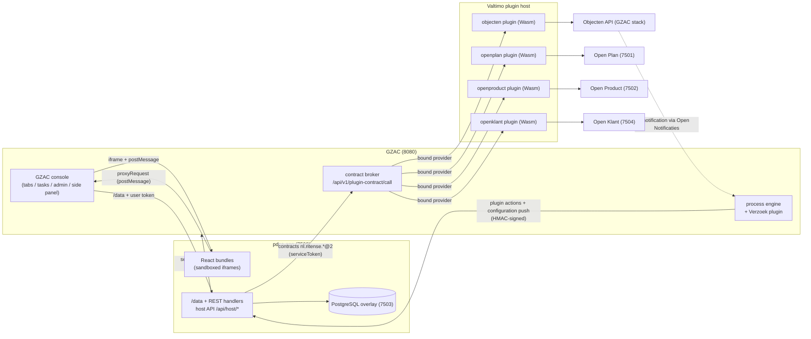
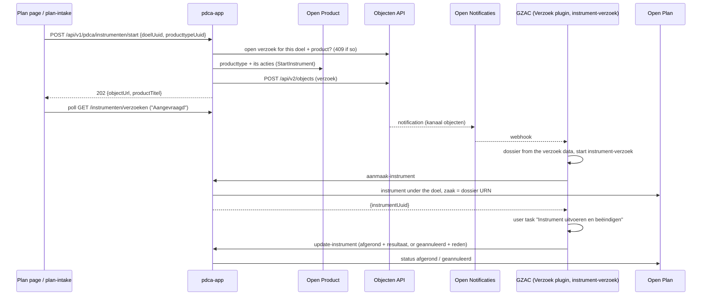

# PDCA app — Architecture

**This document is the single source of truth for the design and workings of
the PDCA app.** Every change to a feature, endpoint, data model, integration,
configuration or flow updates it in the same change. Setup and operation
live in [`README.md`](./README.md); the GZAC case definitions in
[`gzac/case-definitions/README.md`](./gzac/case-definitions/README.md), the
local GZAC dev setup in
[`gzac/dev-setup/README.md`](./gzac/dev-setup/README.md) and the
register plugins in [`plugins/README.md`](./plugins/README.md).

**Part 1 — Design core:** [1 Purpose](#1-purpose-and-context) ·
[2 Principles](#2-principles) ·
[3 Components](#3-components-and-responsibilities) ·
[4 Trust model](#4-trust-model) · [5 Data ownership](#5-data-ownership) ·
[6 Main flows](#6-main-flows) ·
[7 Failure and idempotency](#7-failure-and-idempotency-model) ·
[8 Platform dependencies](#8-platform-dependencies) 
**Part 2 — Reference:** [9 API surface](#9-rest-and-data-api-surface) ·
[10 Overlay data model](#10-overlay-data-model) ·
[11 Configuration](#11-configuration) ·
[12 GZAC configuration](#12-gzac-configuration-as-code) ·
[13 Frontend](#13-frontend-surfaces-and-ui-behaviour) ·
[14 Maintaining this document](#14-maintaining-this-document)

# Part 1 — Design core

## 1. Purpose and context

The PDCA app supports plan management along the Plan-Do-Check-Act cycle for
the plans of an inwoner (Werk & Participatie) or an object. It is an
**overlay** on Maykin's Common Ground registers, which are the system of
record for all plan data:

[Open Plan](https://github.com/maykinmedia/open-plan) (plannen, doelen,
instrumenten, personen; Plannen API v0),
[Open Product](https://github.com/maykinmedia/open-product) (the producttypen
catalog; Producttypen API v1),
[Open Klant](https://github.com/maykinmedia/open-klant) (contactmomenten as
klantcontacten; Klantinteracties API v1) and the
[Objecten API](https://github.com/maykinmedia/objects-api) (the verzoeken by
which a product is requested; Objects API v2).

The app runs inside **Valtimo/GZAC** as an external plugin of the *URL app*
kind: GZAC discovers it by URL, embeds its React bundles as sandboxed iframes
(case tabs, a task form, an admin page and a side panel), runs the dossiers
and processes around the plans, and brokers the app's access to the
registers through plugin contracts. The app is one Spring Boot service
(Kotlin, Spring Boot 3.5, JDK 21, port 7500) with its own PostgreSQL
database for the overlay: only what the registers do not model.

## 2. Principles

1. **The registers are the source of truth**, in their native shape (Dutch
   camelCase, statuses `actief`/`afgerond`/`geannuleerd`,
   `{count, results}`). The bundles read them through a thin register proxy
   that passes paths, bodies and status codes through unchanged.
2. **The overlay is minimal and keyed by register uuid**: no copies of
   register data, only what the registers cannot hold, and links (§5).
3. **Registers only through GZAC's register plugin contracts.** The app holds
   no register URL or credential; every register call is a call of that
   register's contract (`nl.ritense.<register>@2`) (§3.3).
4. **Cross-register references are URNs**
   (`urn:pdca:<component>:<resource>:<id>`), formatted and parsed only by
   `PdcaUrn` in the backend and `frontend/src/shared/urn.ts`. Kinds: persoon
   (`urn:pdca:brp:persoon:<bsn>`), object, klant, persoonsprofiel,
   medewerker, producttype (`urn:pdca:openproduct:producttype:<code>`) and
   dossier (`urn:pdca:gzac:dossier:<caseDefinitionKey>:<documentId>`). The
   formats are stored in the registers and do not change.
5. **The backend owns the business rules.** Everything that spans several
   objects or carries a rule is a backend use case; the browser writes only
   the single-object edits the access policy allows (§9.2).
6. **One owner per lifecycle.** An instrument with an instrument dossier is
   ended by that dossier only; a subdoel is started by the backend rule; the
   plan's hoofddoel and status live in Open Plan only (§6.3).
7. **GZAC dossiers drive processes.** Plan = plan dossier (1:1, created
   together, §6.1); every requested product runs in its own instrument
   dossier (§6.2). The app runs no process of its own.
8. **Trust is explicit**: a request is signed by GZAC, a user's call through
   `/data`, or a public file; everything else is refused (§4).
9. **No outbound HTTP inside a database transaction; every multi-step use
   case is safe to repeat** (§7).
10. **Configuration as code, without environment values**: case definitions
    are versioned zips in `gzac/`; configuration UUIDs and objecttype URLs
    are resolved at import or read from the registers (§12).

## 3. Components and responsibilities

### 3.1 App backend (`src/main/kotlin/com/ritense/pdca/`)

| Package | Responsibility |
|---|---|
| `config/` | Spring configuration: `PdcaProperties` (`pdca.*`), the security filter chain `SecurityConfig` (§4), the register RestClients (`RegisterClientConfig`), the serviceToken cipher (`ServiceTokenCipher`), startup info |
| `domain/` | JPA entities of the overlay (§10), `ServiceTokenConverter`, `PdcaUrn` (§2) and `Bsn` (elfproef) |
| `plugin/` | The URL-app contract towards GZAC: manifest and host API (`PluginHostController`), bundle files (`BundleController`), pushed configurations (`ConfigurationStore`), the active configuration (`GzacAccess`), plugin actions (`PluginActionController`) and the `/data` entry (`PluginDataController`) |
| `registers/` | The register descriptions (`Register`), the contract transport (`RegisterContractRequestFactory`) with its limiter (`ContractCallLimiter`), the pager (`RegisterPager`), the error mapping (`RegisterException`), the typed gateways per register (`openplan/`, `openproduct/`, `openklant/`, `objecten/` on `RegisterGateway`), the register proxy (`RegisterProxyController`) and the display-only stubs (`RegisterStubController`, `StubRegisterService`) |
| `repository/` | Spring Data repositories, including the atomic reserve/claim of `PlanIntakeRepository` |
| `security/` | The trust boundary (§4): `HostSignatureVerifier`/`HostSignatureFilter`, `GzacInstances`, `UserVerifier`, `PdcaUser`, `DataRateLimiter`, `DataAccessPolicy`, `PlanScope`, `DataDispatch` |
| `service/` | The use cases: `PlanIntakeService` (plan from intake) and `IntakeService` (prefill), `DossierLinkService`, `InstrumentAanvraagService` (verzoeken) and `InstrumentActionService` (plugin actions), `PlanLifecycleService`, `DoelLifecycleService`, `InstrumentLifecycleService`, `PlanOverlayService`, `ContactmomentService` and `KlantcontactService`, `EvaluationSessionService`, `BetrokkeneService`, `ActionService`, `PhaseConfigService`, and `GzacClient` (all GZAC calls) |
| `web/rest/` | REST resources under `/api/v1/pdca/*` and `/api/v1/admin/*` (§9) and `ErrorResponseAdvice` (§7) |

Controllers only map HTTP to service calls; the rules live in the services.

### 3.2 React bundles (`frontend/`)

Six bundles, one per GZAC surface (§13): three case tabs, the PDCA Beheer
page, the create-plan task form and the evaluation side panel. Vite builds
them into `src/main/resources/static/bundles/react/`; `./gradlew build`
runs that build before packaging, so the jar always carries them, and
`BundleController` serves them at `/plugins/pdca/{version}/bundles/*`. A
bundle fetches nothing but its own files from the app and nothing from third
parties; every API call goes through the GZAC host to `/data` (§4.4).

### 3.3 Register plugins and contracts (`plugins/`)

Each register has its own contract and its own external plugin, a Wasm
plugin on a Valtimo plugin host that holds the register URL and token (its
only egress target) and makes the HTTP request. Each contract offers exactly
the resources and operations the app uses:

| Register | Contract | Plugin | API path | Resource: operations |
|---|---|---|---|---|
| Open Plan | `nl.ritense.openplan@2` | `openplan` | `/plannen/api/v0` | `plan`: list, get, create, update; `doel`, `instrument`: list, get, create, update, delete; `persoon`: list, create; `doeltype`, `instrumenttype`, `relatietype`, `plantype`, `overkoepelendplan`: list |
| Open Product | `nl.ritense.openproduct@2` | `openproduct` | `/producttypen/api/v1` | `producttypen`: list, get; `acties`: list |
| Open Klant | `nl.ritense.openklant@2` | `openklant` | `/klantinteracties/api/v1` | `klantcontacten`: list, get, update; `maak-klantcontact`: create; `partijen`: list, create |
| Objecten API | `nl.ritense.objecten@2` | `objecten` | `/api/v2` | `objects`: list, create — confined to the configured verzoek objecttype |

The four plugins (version 2.0.0) share one core (`plugins/register-core/`):
the contract handler and the configuration screen. A plugin is its manifest
plus a `RegisterSpec` (contract, API path, configuration properties and the
allowlist), so a request outside the allowlist is refused in the plugin
before it leaves the plugin host. `RegisterContractFootprintTest` keeps the
allowlists exactly as wide as the app's use: it calls every public gateway
method against a recording transport, translates the register proxy routes
(§9.2) the same way, and fails when the app uses a resource, operation or
query parameter a plugin does not allow, or a plugin allows an operation the
app never uses. The `objecten` plugin adds
`type=<verzoek objecttype>` to every listing and refuses objects of another
objecttype, so its Objecten API token only serves the verzoeken. Build,
error codes and installation: [`plugins/README.md`](./plugins/README.md).

Inside the app:

- **One transport per register.** Each register has one RestClient
  (`openPlanRestClient`, …) with the placeholder base URL
  `http://<register>.contract` and a `RegisterContractRequestFactory`, so
  code issues ordinary register API requests. The factory maps a request
  onto an operation by path and query only (so the registers' absolute
  `next` links work too): GET on a collection `list`, GET on
  `/<resource>/<uuid>` `get`, POST on a collection `create`, PATCH on an
  object `update`, DELETE on an object `delete`, with payload
  `{resource, uuid?, query?, body?}`; any other shape is a local 400. It
  posts the call to `POST /api/v1/plugin-contract/call` with the active
  configuration's serviceToken; GZAC resolves the bound provider from it.
- **Responses are reproduced.** The plugin answers `{status, body}` with the
  register's own status and body, also for 4xx/5xx, and the factory turns
  that back into an HTTP response, so `invalidParams` and 404s arrive as
  from the register itself.
- **Typed gateways.** Services reach a register only through its gateway
  (`OpenPlanGateway`, `OpenProductGateway`, `OpenKlantGateway`,
  `ObjectenGateway`): encoded URIs, typed DTOs in the register's shape,
  server-side filters where the register has them. Only the proxy uses the
  RestClients directly.
- **Binding.** The administrator binds each contract when activating the
  PDCA configuration in GZAC (preselected when exactly one provider exists);
  GZAC pushes the bound contracts as `grantedContracts`, so the app tells
  "register not bound" from "GZAC unreachable" without calling GZAC.

### 3.4 GZAC

- **Host.** GZAC discovers the app at `GET /api/host/plugins` (manifest:
  plugin `pdca`, "PDCA Planbeheer", version `0.2.0`, capabilities
  `gzac_api` and `frontend_data`, granted endpoints, contracts, bundles and
  actions), pushes configurations and announces its frontend origins
  (§4.3), embeds the bundles and relays their API calls to `/data` (§4.4).
- **Contract broker** (§3.3) and **process engine**: the case definitions
  in `gzac/` (§12) run the intake, the plan dossier and the instrument
  dossier, which calls back with the plugin actions `aanmaak-instrument` and
  `update-instrument`; GZAC's Verzoek plugin turns a verzoek into an
  instrument dossier (§6.2).
- **GZAC API for the app.** The app calls GZAC with the pushed serviceToken,
  limited to the endpoints the manifest grants
  (`PluginHostController.GRANTED_ENDPOINTS`, the single source):

  | Endpoint | Used for |
  |---|---|
  | `POST /api/v1/process-document/operation/new-document-and-start-process` | create the plan dossier |
  | `GET /api/v1/document-definition/*` | the case definition version tag of a case type |
  | `GET /api/management/v1/document-definition` | the case-type lists of PDCA Beheer; with the user's token, the admin check |
  | `GET /api/v1/document/*` | read a dossier (intake, plan dossier existence, the dossier type behind `aanmaak-instrument`); with the user's token, dossier access |
  | `GET /api/management/v1/case/*` | the dossier content when `/api/v1/document/*` omits it (GZAC without `valtimo.includeDocumentContentInResponse`) |
  | `POST /api/v1/document-search` | find the plan dossier of a plan (case type + `planId`) before creating one |

  The dev values of the local GZAC setup (`gzac/dev-setup/dev-values.json`)
  repeat these grants; `GzacConfigurationTest` fails when its grants,
  contract bindings or register plugin properties and capabilities differ
  from what the app and the plugins declare, and when the case definitions
  drift from the manifest: a process link's action, properties or result
  mapping not declared (or the action not handled by
  `PluginActionController`), a tab or process link naming another plugin,
  plugin version, configuration or an undeclared bundle, or a case
  definition whose directory, `versionTag` and BPMN version tag disagree on
  its version.
- **Manifest versioning.** The manifest keeps version `0.2.0` when its
  footprint changes: GZAC pins a hash of the manifest and asks the
  administrator to review and accept the change, after which the existing
  configuration, its tabs and process links keep working; GZAC binds a newly
  declared contract itself when exactly one provider exists. Until the
  administrator has accepted a newly granted endpoint (such as the document
  search) the app's calls to it are refused, and the use case that needs it
  answers 502 asking for exactly that.

## 4. Trust model

### 4.1 Callers and routes

Every request the app accepts is **signed by GZAC**, a **user's call through
`/data`**, or a **public file**. Everything else is refused by
`SecurityConfig`: 401 without credentials, 403 outside the caller's reach.

| Caller | Route | Authenticated by | Authorized by |
|---|---|---|---|
| GZAC backend | `/api/host/**`, `POST /plugins/pdca/{version}/actions/{key}` | HMAC signature with the host secret (§4.2) | the signature; a push or announcement also by the allowed base URLs; an action also by the active configuration |
| GZAC frontend, for a bundle | `POST /plugins/pdca/{version}/data` | the user token in the body, introspected at GZAC | the active configuration, the rate limit and the access policy (§4.4) |
| Browser | `GET /plugins/pdca/{version}/bundles/**`, `GET /plugins/pdca/{version}/plugin-manifest` | — (public) | — |
| GZAC health poll | `GET /health` | — | — |
| Anyone, any other path (including `/api/v1/**` and the register proxy called directly) | — | 401 | — |

The REST handlers under `/api/v1/**` and the register proxy are reachable
only through an internal forward that `/data` makes for a verified user
(§4.4). In the other direction the app calls GZAC with the pushed
**serviceToken** for its own work (granted endpoints and contract calls)
and with the **user's token** for every question about the user.

### 4.2 GZAC's signature

GZAC signs every call to the app except the health poll with
`X-Valtimo-Signature`: lowercase hex HMAC-SHA256 over
`{METHOD}\n{path}\n{timestamp}\n{sha256-hex(body)}`, with the ISO-8601
timestamp in `X-Valtimo-Timestamp`; the path is without query string.
`HostSignatureFilter` reads the body once (at most 1 MB, else 413), verifies
it against exactly those bytes and hands them on to the controller. It
compares in constant time, accepts a timestamp within
`pdca.host.signature-tolerance` (5 minutes) of its own clock and refuses a
signature it already accepted for a state-changing request (a replay; the
memory is per replica). A missing or wrong signature is a bare 401; the app
logs method, path and reason, never the signature.

The key is `pdca.host.secret` (`PDCA_HOST_SECRET`, at least 16 characters,
else the app does not start): the secret entered for the PDCA integration in
GZAC. Its default `dev-only-insecure-secret` is the documented local-dev
secret (also the dev descriptor's default); the app logs a WARN at startup
while it is in use.

### 4.3 Configurations, GZAC instances and GZAC access

- **Configuration push.** When a PDCA configuration is created or saved, and
  on every discovery poll, GZAC pushes `configId`, `serviceToken`,
  `gzacBaseUrl`, `title`, properties, event subscriptions and
  `grantedContracts` to `POST /api/host/configurations/{configId}`. The app
  persists it (`StoredPluginConfiguration`), logs configId, title, GZAC host
  and granted contracts only, and never returns the token
  (`GET /api/host/configurations` lists configurations without it).
- **The serviceToken at rest** is encrypted with AES-256-GCM
  (`ServiceTokenConverter`; stored as `v1:` + base64 of IV and ciphertext),
  with a key derived by PBKDF2-HMAC-SHA256 from `pdca.encryption.secret`
  (`PDCA_ENCRYPTION_SECRET`; the local-dev default triggers a startup WARN).
  A stored token that does not decrypt (another secret) reads as absent
  until GZAC's next push.
- **The active configuration.** Exactly one pushed configuration is used,
  and which one never depends on push order (`GzacAccess`,
  `ActiveConfigurationSelector`): `pdca.gzac.configuration-id`
  (`PDCA_GZAC_CONFIGURATION_ID`) names it; without that property GZAC must
  have pushed exactly one configuration with a serviceToken. None, a named
  one not pushed, or several without a name make every GZAC and register
  call answer 503 with the reason (several also log an ERROR naming the
  configIds). `/data` and the plugin actions accept only calls for the
  active configuration.
- **GZAC address.** The pushed `gzacBaseUrl` is GZAC's server-to-server
  callback URL; `pdca.gzac.base-url` (`GZAC_URL`, no default) overrides it
  where the app sees GZAC under another address (the compose container via
  `host.docker.internal`). The app holds no GZAC credentials of its own.
- **Pinning GZAC.** With `pdca.gzac.allowed-base-urls`
  (`PDCA_GZAC_ALLOWED_BASE_URLS`) set, a push or announcement naming another
  `gzacBaseUrl` is refused (403), so even a holder of the host secret cannot
  point the app at another GZAC.
- **Instance announcements.** GZAC announces itself with
  `PUT /api/host/gzac-instances` (`{gzacBaseUrl, frontendOrigins}`) on
  registration and every discovery poll; the app keeps those origins in
  memory (`GzacInstances`, at most 20 per instance) and adds them to the
  configured `pdca.gzac.frontend-origins` (§4.6).

### 4.4 A call through `/data`, end to end

1. The bundle posts `proxyRequest {correlationId, target: "plugin", method,
   path, query, body}` to its parent window (bridge `pluginData`).
2. GZAC's frontend accepts it only from its own iframe and posts
   `{configurationId, method, path, query, body, context, userToken}` to
   `{app}/plugins/pdca/{version}/data` — a cross-origin `fetch` from the
   GZAC frontend's origin. The user token is a downscoped token GZAC mints
   per user and configuration (at most 15 minutes, refreshed by GZAC); it
   never enters the iframe. `context` is the surface's context (dossier,
   case type). GZAC passes the answer's status and body back unchanged.
3. `PluginDataController` refuses a query string of its own or an unreadable
   body (400), a body over 1 MB (413), no active configuration (503), a
   call for another configuration (403) and a missing token (401).
4. `UserVerifier` answers from its cache, keyed by the token's SHA-256: a
   verified user for at most 60 seconds and never beyond the token's
   expiry, a refused token for 30 seconds (401 without asking GZAC). Only
   on a miss does the call cost an introspection, and only then is it
   counted against the **introspection buckets** — first its client
   address's, then the configuration's (429 over either, before GZAC is
   asked). The token is then introspected at
   `GET {gzac}/api/v1/external-plugin/user-token/introspect`
   (`{subject, configurationId, expiresAt}`, no roles). A refused or expired
   token, or one for another configuration, is a 401; an unreachable GZAC a
   503 — every check fails closed. Then every call of the verified user is
   counted against the **user's bucket**.
5. `DataAccessPolicy` matches the call against its route table: method, a
   path of plain segments (no `.`/`..`, nothing encoded) and only that
   route's query parameters. No match is a 403. The route resolves to a
   requirement — any user, admin, or "can read these dossiers"
   (`PlanScope`) — which `UserVerifier` checks (§4.5).
6. The controller forwards the call inside the servlet container to its
   path, with the call's method and JSON body and none of the browser's
   headers, as the verified user (`PdcaUserAuthentication`, read by handlers
   through `CurrentUser`), marked with a `DataDispatch`. Only such a forward
   passes `SecurityConfig` to `/api/v1/**` and the register proxy. The
   handler's status and body are the answer of `/data`.

**Rate limit** (`DataRateLimiter`): token buckets, each holding at most its
limit and refilling at that limit per window (`pdca.data.rate-limit`, per
minute by default; 0 switches a bucket off). Over a limit: 429 with
`Retry-After` and the Dutch `detail` "Te veel aanvragen; probeer het over
een moment opnieuw".

| Bucket | Counts | Default |
|---|---|---|
| per client address | calls that cost an introspection (token not cached) | 300 |
| per configuration | the same calls, all addresses together | 6000 |
| per user | every call of a verified user | 600 |

The configuration id is visible to every GZAC user, so anyone can post
`/data` calls with made-up tokens. Such a flood is answered from the
refused-token cache when it repeats a token, stops at its own address's
bucket when it does not, and can at most use up the configuration's
introspections: users whose token is cached are not counted there and keep
working; only tokens new in that window wait. The client address is the
TCP peer, or behind a reverse proxy the browser's address from the
proxy's `X-Forwarded-For` (`SERVER_FORWARD_HEADERS_STRATEGY=native`, the
chart's default); behind a proxy without it all browsers share the proxy's
bucket. The buckets live in memory per replica, so with several replicas
the effective limit multiplies.

### 4.5 Who may do what

The complete route table is in §9.2. In short:

- **Any verified user** — reference data, the display stubs and the user's
  own evaluation session (whose handlers act for that user only).
- **Plan data** — the user must be able to read the plan's dossier.
  `PlanScope` resolves the target to its plan(s) — a doel or instrument
  through its overlay row, else Open Plan (`doel.plannen`,
  `instrument.doelen`); a contactmoment, actie or betrokkene through the
  overlay; an upsert also through the `planUuid` in its body — and each plan
  to its dossier (`plan_details.dossier_id`). No dossier, no access (403).
- **Dossier routes** — the plan of a dossier, the prefill, plan creation and
  an evaluation start check the dossier they name.
- **PDCA Beheer** — GZAC administrators. The introspection carries no roles,
  so the user's token asks
  `GET /api/management/v1/document-definition?page=0&size=1`, which GZAC
  opens only to `ROLE_ADMIN`.
- **Dossier access** is asked as the user (`GET /api/v1/document/{id}` with
  the user token, so GZAC applies the user's PBAC; 4xx is no access, an
  outage 503). Granted access is cached per (user, dossier) for 2 minutes,
  the admin answer per token for at most 5 minutes.
- **Register proxy** — only the reads the bundles make and three
  field-checked single-object edits; every write with a business rule is a
  backend use case without proxy route.

### 4.6 Browser headers

- **Framing**: CSP `frame-ancestors` lists the GZAC frontend origins —
  `pdca.gzac.frontend-origins` (`PDCA_GZAC_FRONTEND_ORIGINS`, default
  `http://localhost:4200`) plus the announced ones; `'none'` when there are
  none. There is no `X-Frame-Options`.
- **CORS**: `/data` answers CORS to those same origins (POST,
  `Content-Type`, no credentials); the bundle files and the manifest to `*`
  (GET), because the sandboxed iframe loads its scripts, styles and fonts
  with `Origin: null` and the GZAC frontend reads the manifest. No other
  path answers CORS.
- **No ambient credentials**: no sessions or cookies, so CSRF has nothing to
  abuse; every state-changing request carries a signature or a user token
  in its body.

### 4.7 Secrets

| Secret | Source | In the app |
|---|---|---|
| Host secret | entered for the PDCA integration in GZAC | `PDCA_HOST_SECRET`; verifies GZAC's signatures |
| serviceToken | pushed by GZAC with the configuration | encrypted at rest with `PDCA_ENCRYPTION_SECRET`; the app's own GZAC and contract calls |
| User token | minted per user by GZAC's frontend, sent with every `/data` call | in memory only; caches keyed by its hash |
| Register URLs and tokens | the register plugin configurations in GZAC | never |

Credentials are never logged: not the serviceToken, a user token, a
signature or GZAC's answers about a user.

## 5. Data ownership

### 5.1 Who holds which fact

| Fact | Source of truth | Notes |
|---|---|---|
| Plan: titel, plantype (the dienstverlening), status, start/einddatum, `redenEinde`, `notitie`, subject (`domeinregister` URN), procesbegeleider (`medewerker` URN) | Open Plan | `plan.zaak` is not used |
| Persoon of a plan | Open Plan | created from the bsn when Open Plan does not know it |
| Doelen: hoofddoel and subdoelen, hierarchy (`doel.hoofdDoel`), doeltype, status, resultaat, `toelichtingResultaat` | Open Plan | the plan's hoofddoel is its actief doel of a hoofddoel type; no overlay copy |
| Instruments: titel, status, `product` URN, `zaak` (instrument dossier URN), instrumenttype | Open Plan | managed by the instrument dossier (§6.2) |
| Reference data: doeltypen (category `Hoofddoel` marks hoofddoel types, other categories are themas), plantypen, instrumenttypen, relatietypen | Open Plan | seeded in the dev stack |
| Producttypen, their themas and doelgroep, the `StartInstrument` actie and parameters `startStatus`/`instrumenttype` | Open Product | decide what can be requested and how (§6.2) |
| Contactmomenten (planned and taken place) with onderwerpobject and betrokkene partij | Open Klant | klantcontacten (§6.4) |
| Verzoeken (product requests) | Objecten API | the app keeps no record of them (§6.2) |
| Plan ↔ plan dossier, plan ↔ intake, case type, persoon, display status, positie, subdoelgroep, streefdatum | overlay `PlanDetails` | |
| Progress of plan creation from an intake | overlay `PlanIntake` | reservation and lease (§6.1) |
| Uitvoeringsstatus Gepland/Gestart, voortgangsstatus and toelichting, notes, sort order of a doel | overlay `DoelDetails` | refinement of register `actief` |
| Uitvoeringsstatus, hours, effectiveness, notes, abort reason of an instrument | overlay `InstrumentDetails` | |
| Evaluation type, planned date, deelnemers, actiepunten, originating evaluation of a contactmoment | overlay `ContactmomentDetails` | keyed by klantcontact uuid |
| Betrokkenen and which one is procesbegeleider | overlay `InvolvedParty` | procesbegeleider mirrored to Open Plan `plan.medewerker` |
| Acties | overlay `Action` | |
| Evaluation sessions and the plan changes recorded in them | overlay `EvaluationSession`, `EvaluationChange` | |
| Case configuration per case type | overlay `PhaseConfig` (§10.2) | |
| Pushed plugin configurations | overlay `StoredPluginConfiguration` | token encrypted |
| Announced GZAC frontend origins | app memory | re-announced on every poll |
| Dossiers, processes, tasks, users, PBAC, admin role | GZAC | |
| Register URLs and tokens | register plugin configurations in GZAC | |
| Subject display data (BRP persoon, object) | out of scope | display-only stubs with demo data when `pdca.display-stubs.enabled` |

### 5.2 One status vocabulary

The status of a doel, instrument, actie, plan and contactmoment is shown with
the same words everywhere (`frontend/src/shared/labels.ts`):

| Object | Gepland | Gestart | Afgerond | Afgebroken |
|---|---|---|---|---|
| Subdoel | register `actief` + overlay GEPLAND | `actief` + GESTART | `afgerond` (resultaat `gefaald`: *Niet behaald*) | `geannuleerd` |
| Hoofddoel | `actief` + overlay GEPLAND | `actief` otherwise | `afgerond` | `geannuleerd` |
| Instrument | `actief` + overlay GEPLAND | `actief` otherwise (also without overlay row) | `afgerond` | `geannuleerd` |
| Actie | PLANNED | IN_PROGRESS | COMPLETED | — (plus *Ter beoordeling* PENDING_REVIEW, *Afgekeurd* REJECTED) |
| Plan | — (the configured display status while `actief`) | — | `afgerond` | `geannuleerd` |

A contactmoment is *Afgerond* when `indicatieContactGelukt` is true,
*Gepland* (or *Verlopen* once its date passed) when it is null, *Niet
gelukt* when false.

**Voortgangsstatus** — next to its lifecycle, a running hoofddoel or subdoel
says how it is going: one of the plan case type's voortgangsstatussen
`{code, naam, betekenis}` (§10.2; standard list *Op koers*, *Aandacht
nodig*, *Loopt achter*). The `code` is stored on the doel, the `betekenis`
(`GAAT_GOED`, `LET_OP`, `GAAT_NIET_GOED`) gives colour and KPI. It can only be
set while the doel is `actief` in Open Plan (409 otherwise) and must be in
the plan's list (400); it never changes the register status. A doel whose
status was removed from the list keeps showing it (grey).

**Procesbegeleider** — the betrokkene with `isPrimary`, at most one per plan
(partial unique index). `BetrokkeneService` writes it to Open Plan as
`plan.medewerker` (`urn:pdca:medewerkers:medewerker:<name, whitespace and
dots collapsed to single dots, lowercase>`, empty when none) first, then
updates the betrokkenen in one transaction, and sets Open Plan back to the
previous procesbegeleider when that fails.

## 6. Main flows

### 6.1 Intake → plan

A plan and its plan dossier come into existence together, in one way only:
the `create-plan` task form on the last user task of an **intake dossier**
calls `POST /api/v1/pdca/plan-intake` (`PlanIntakeService`). Plan dossiers
have no user tasks and cannot be started by hand (§12).

- **Case types.** The intake case type's configuration names the plan case
  type (`planCaseDefinitionKey`) and the prefill mapping; without
  `planCaseDefinitionKey` a dossier is no intake and `POST /plan-intake`
  refuses it (400). The plan is never linked to the intake dossier itself:
  the app creates a **new plan dossier** of the plan case type.
- **Prefill.** `GET /dossiers/{id}/plan-prefill` (`IntakeService`) reads the
  intake dossier's content through GZAC (no content is an explicit error)
  and maps it to a proposal, from just a bsn up to a complete plan. When it
  fails the form shows the reason and offers no plan creation. The form
  fills empty plan administration with defaults (titel "Plan – <naam>",
  startdatum today, the first display status, one evaluation six weeks on).
- **One active plan per inwoner per plan case type.** `POST /plan-intake`
  refuses a person intake while one exists (overlay rows give the
  candidates, the register status decides); reopening a plan applies the
  same rule.

`POST /plan-intake` is **safe to repeat and never reports a half-built plan
as done**:

1. **Validate first.** Everything that can be checked is checked before the
   first write, and every problem is reported in one 400: doeltypen,
   statuses and resultaten, dates, lengths (titel ≤ 255, toelichtingen and
   evaluation notes ≤ 1000, the registers' limits), evaluation types,
   positie and display status against the plan case type, betrokkenen, the
   subject and the one-active-plan rule (plans of this intake excepted).
2. **Reserve.** A `PlanIntake` row keyed by the intake dossier is inserted
   (`ON CONFLICT DO NOTHING`) and claimed in one atomic update with a random
   claim token and a lease of ten minutes, before any register write. A
   second request while the claim holds gets 409 *"Het plan wordt al
   aangemaakt; …"*; a crashed request's claim expires with its lease. The
   holder renews the lease before every step (and every verzoek), and every
   later write of the row — renewing, recording the plan uuid, GEREED,
   releasing — is one conditional update on its token; the row is never
   saved as a whole. A request whose lease ran out and was claimed by
   another stops at its next write with the same 409 and changes nothing,
   not even the other's claim.
3. **Build, resuming.** Each step first looks up what an earlier attempt
   left: the persoon by bsn; the plan from the reservation (a plan of this
   subject and titel without overlay row — one whose creation answer got
   lost — is adopted); the overlay row; the hoofddoel as the actief doel of
   its type (with a GESTART overlay row) and the subdoelen per doeltype,
   each pointing at the hoofddoel through `doel.hoofdDoel`; the
   contactmomenten per date, type (from their overlay row, else from the
   klantcontact's onderwerp) and state (§6.4); the betrokkenen and the
   procesbegeleider; the plan dossier through
   `DossierLinkService.ensurePlanDossier` (with subject line `onderwerp`,
   the first column of the plan case lists; before creating one it searches
   GZAC for a dossier of the plan case type whose `planId` is this plan —
   one whose creation answer got lost, or whose link was not saved — and
   links that instead); and finally the verzoeken
   (§6.2), counted per subdoel and product so a retry files only what is
   missing. A temporary failure fails the call and leaves the reservation
   IN_AANMAAK; submitting again completes it (`hervat: true`).
4. **Done.** Only then is the reservation GEREED, and only a GEREED plan is
   reported as existing: a repeat submission gets that plan back
   (`bestaand: true`). A GEREED plan that no longer exists in Open Plan
   frees the intake for a new plan; its old overlay (including evaluations)
   is removed then. Every successful answer carries the plan dossier, so the
   task form completes its task only on a complete plan.

**Instruments of the intake** are not created by the call: each row becomes
a verzoek through the same `InstrumentAanvraagService` as the plan page
(by producttype code), so every instrument gets its own instrument dossier.
A row names its subdoel by doeltype name (no name or a duplicate doeltype:
the first match, with a warning; an unknown name: not requested, a
warning). A product is requested once per subdoel: a second row for the
same subdoel and product is dropped up front with a warning (*"Instrument
'<code>' staat meer dan eens onder subdoel '<doel>'; één keer
aangevraagd"*). A row the registers refuse (unknown producttype, no
`StartInstrument` actie, an open verzoek, a closed subdoel) becomes a
warning (*"Instrument '<code>' niet aangevraagd: <reden>"*) instead of
failing the plan; the answer counts the rows covered by a verzoek
(`instrumentenAangevraagd`).

**Back into the intake.** The task form submits its result `doc:`-prefixed
(`doc:planId`, `doc:planTitel`, `doc:planDossierId`), so it lands in the
intake document and outlives the process (unprefixed keys would become
process variables); the intake's *Aangemaakt plan* widget links to the plan
dossier. The form's request to navigate there is usually skipped by GZAC
because it follows the slow creation call (§13.2). The plan tabs find the
plan of their dossier with `GET /dossiers/{id}/plan` (404: no plan);
nothing links, unlinks or creates a dossier on read. The intake case types
themselves (DVKM decision table, phase statuses, widget summary tab) are
described in
[`gzac/case-definitions/README.md`](./gzac/case-definitions/README.md).

### 6.2 Instrument request → verzoek → instrument dossier

Requesting a product (an Open Product producttype) for a doel is **the only
way an instrument gets into a plan**, from the plan page ("Instrument
aanvragen") and for the instruments of an intake (§6.1). The app holds no
configuration for it: the registers say what can be requested and how, the
Objecten API carries the request, and GZAC runs one dossier type for every
product (`InstrumentAanvraagService`, `InstrumentActionService`).

- **What can be requested.** A producttype carrying an actie named
  `StartInstrument`. Under a subdoel the plan page and the create-plan form
  offer those that fit it (`producttypenVoorDoel` in `labels.ts`): sharing
  a **thema** with the subdoel's doeltype (its categories other than
  `Hoofddoel`; a doeltype without themas scopes nothing) and with a
  **doelgroep** matching the plan's subject (persoon → `burgers`, object →
  `bedrijven_en_instellingen`; none fits everywhere).
- **The start recipe** is the actie's `mapping`: static `soort` (`verzoek`,
  the only kind), static `type` (the verzoek objecttype URL —
  environment-specific, so it lives in the register) and `typeVersion`
  (default 1); other static items are copied into the verzoek data; lists
  under `plan`, `doel` and `producttype` map a value of that register object
  (path in `regex`, e.g. `$.uuid`) onto a verzoek field. The producttype
  parameters `startStatus` (`actief`, or `gepland`) and `instrumenttype`
  (name or uuid of an Open Plan instrumenttype) shape the instrument. A
  missing actie or objecttype is a 422 with the reason.
- **The verzoek.** `POST /instrumenten/start` creates an object with
  `record.data = {type: "instrument", bsn?, data}` (the shape GZAC's Verzoek
  plugin expects; `bsn` only for a persoon plan), `data` holding
  `planUuid`, `doelUuid`, `subjectId`, `productTypeUuid`,
  `productTypeCode`, `productTitel`, `productUrn`, `startStatus`,
  `instrumenttype`, `aangevraagdOp` and the recipe's extras. It answers 202
  and keeps nothing; it refuses (409) a doel or plan that no longer runs and
  a doel and product with an open verzoek. The check and the filing run
  under an in-memory lock per doel and product, so two concurrent requests
  on one replica cannot both pass the check; with several replicas, two
  requests for the same doel and product that reach different replicas at
  the same moment can still both be filed (each becomes its own dossier).
- **The instrument dossier.** GZAC's Verzoek plugin matches `type`
  `instrument`, creates an `instrument-verzoek` dossier with the verzoek
  data as document and starts its process: `aanmaak-instrument` → user task
  (afronden with resultaat, or annuleren with a reason) →
  `update-instrument` → end. The process knows no product. All three
  service tasks are asynchronous jobs retried every minute, five times
  (§7.4): completing the user task always succeeds for the behandelaar,
  and the instrument's status in the plan follows shortly after, once the
  job has run.
- **`aanmaak-instrument`** (`doelUuid`, `titel`, optional `product`,
  `status`, `instrumenttype`, `planUuid`) creates the instrument with the
  calling dossier as `zaak` (dossier URN, case type read from the document).
  It is **retry-safe**: it first lists the doel's instruments with that
  `zaak` and returns the one an earlier attempt created. It refuses a doel
  or plan that is no longer actief, falls back to the register's first
  instrumenttype (WARN) when the named one does not exist, applies the
  subdoel rule (§6.3) and returns `instrumentUuid` as declared output,
  mapped to `doc:/instrumentUuid`.
- **`update-instrument`** (`instrumentUuid`, `status` `afgerond` with
  optional `resultaat` behaald/gefaald or `geannuleerd`, optional
  `toelichting`, `planUuid`) ends the instrument; the toelichting goes to the
  overlay (`effectiviteitToelichting`, or `afbreekReden`). The requested end
  state already reached is a success without a write; an otherwise closed
  instrument is refused. Answers and retries: §7.4.
- **One owner per instrument.** An instrument whose `zaak` is a dossier URN
  — every instrument the app creates — is managed by its dossier only: the
  plan page shows its status and a **Dossier** button (navigating to
  `/cases/{caseDefinitionKey}/document/{documentId}`) instead of Afronden
  and Afbreken, and `POST /instrumenten/{uuid}/afronden|afbreken` refuse it
  (409). *Starten* stays: it refines `actief`, which the dossier does not
  model. An instrument without dossier URN (older data) keeps both.
- **Open verzoeken.** A verzoek leaves no record in the app, so its state is
  read back: per doel and product (`productUrn`), the verzoeken in the
  Objecten API (listed with a `data_attrs` filter on the plan) that
  outnumber the instruments under that doel with that `product` and a
  dossier `zaak` are **open**, the oldest counting as fulfilled first.
  `GET /instrumenten/verzoeken?planUuid=` lists them with `aangevraagdOp`
  and `minutenOpen` (§13.3). With the 409 above and the per-subdoel count in
  plan creation, neither a slow notification route nor a retry files
  duplicates. The app does not check the dossier type's process links
  (§12): a verzoek filed before they are in place waits to be picked up.

### 6.3 Plan, doel and instrument lifecycle

Every lifecycle step is a backend use case (`PlanLifecycleResource`), one
endpoint per user intent; the browser writes no multi-object change to the
registers itself.

- **Instrument** (`InstrumentLifecycleService`): start
  (`POST /instrumenten/{uuid}/starten`, overlay GESTART), complete
  (`…/afronden`) or abort with a reason (`…/afbreken`); the last two refuse a
  dossier-managed instrument (409) and do not write the register again for
  one already in that end state — completing one that is afgerond already
  still starts its gepland subdoelen, so a retry after a failure between
  the two steps completes the second.
- **A subdoel starts with its first started instrument.** Whenever an
  instrument is created as gestart (`aanmaak-instrument`), started, or
  completed (plan page or `update-instrument`), every actief subdoel it
  belongs to that is still Gepland becomes Gestart
  (`InstrumentLifecycleService.startSubdoelen`). The plan page records the
  subdoelen the backend reports as started in a running evaluation.
- **Doel** (`DoelLifecycleService`): remove (`DELETE /doelen/{uuid}`: its
  own instruments — those under no other doel — and their overlay rows,
  then the doel, its overlay row and acties) or abort with a reason
  (`POST /doelen/{uuid}/afbreken`: its actief instruments geannuleerd with
  "Afgebroken met doel: <reden>", then the doel geannuleerd). Both refuse
  with 409 *"Sluit eerst de instrumentdossiers af: …"* while one of its
  instruments is actief and dossier-managed. Instruments go first and the
  doel last, so a retry completes an interrupted cascade. Completing a
  subdoel and editing its texts are single-object proxy edits.
- **Hoofddoel switch** (`PUT /plannen/{uuid}/hoofddoel`,
  `PlanLifecycleService`): makes an actief doel of the chosen hoofddoel type
  the hoofddoel (the one an interrupted switch created, else a new one),
  completes every other actief hoofddoel (it stays visible as history) and
  re-points the subdoelen. Each step skips what is done. Refused (409) on a
  closed plan.
- **Closing a plan** (`POST /plannen/{uuid}/afronden|afbreken`, reason
  optional resp. required) sets the register status with today as
  `einddatum` and the text as `redenEinde`. `GET /plannen/{uuid}/afsluitcheck`
  reports what is still open: actief subdoelen, actief instruments the
  plan page manages and open verzoeken only warn — closing leaves them —
  but an actief dossier-managed instrument blocks closing (409): its
  dossier has to end it first. A verzoek whose dossier only appears after
  the plan closed fails in `aanmaak-instrument`.
- **Reopening a plan** (`POST /plannen/{uuid}/heractiveren`) clears
  `einddatum` and `redenEinde`, under the one-active-plan rule (409).

### 6.4 Contactmomenten

A contactmoment of a plan is a **klantcontact** in Open Klant, so it is part
of the inwoner's klantbeeld; the overlay row `ContactmomentDetails` keeps
the PDCA side. `KlantcontactService` writes one in a single
`POST /maak-klantcontact`:

- the klantcontact — kanaal `gesprek`, onderwerp `<type>: <plan titel>`
  (the type's Dutch label for the built-in types — Intake, Voortgang,
  Evaluatie, Inspectie, Crisis — and its own key for a configured type, so
  the type reads back from the onderwerp losslessly), the
  verslag as `inhoud` (at most 1000 characters, Open Klant's limit; longer
  is a 400), `vertrouwelijk` true, `taal` `nld`, `plaatsgevondenOp` the
  moment of the conversation;
- an onderwerpobject pointing at the plan (`codeRegister` `open-plan`,
  `codeObjecttype` `plan`, `codeSoortObjectId` `uuid`, `objectId` the plan
  uuid);
- for a persoon plan, the inwoner as betrokkene (rol `klant`): the partij
  with that bsn, created with only its identificator when Open Klant does
  not know it. Object plans get no betrokkene.

Contactmomenten are created by plan creation (§6.1), by completing an
evaluation (§6.5) and by planning one (`POST /contactmomenten` with
`afgerond` false). A **planned** contactmoment has `indicatieContactGelukt`
null and `plaatsgevondenOp` at 12:00 on the planned date in the app's time
zone (one rule for every route, `ContactmomentService`); the overlay keeps
`geplandeDatum`. `PATCH /contactmomenten/{uuid}` with `{datum}` reschedules
it (409 once it took place). Contactmomenten cannot be deleted: they are a
record in the klantbeeld. The tabs read them natively through the proxy,
filtered on the plan's onderwerpobject.

### 6.5 Evaluation

An evaluation is the set of changes made to the plan while it runs, plus the
contactmoment information (type, deelnemers, gespreksverslag). Changes are
made in the plan tabs as always and take effect immediately: an evaluation
is no transaction and cannot be rolled back. It runs in GZAC's app-wide side
panel (bundle `evaluation`, offered with `offerPanel`), which survives
navigation; closing the panel only hides it.

- **Session = user + plan** (`EvaluationSessionService`). The session
  endpoints act for the verified user only, so a running session is visible
  to its owner alone; at most one RUNNING session per user (a second start
  is a 409 with the running one).
- **Start** (`POST /evaluation-sessions`, the tab's dossier must be
  readable) — the session carries out the planned contactmoment passed as
  `geplandContactmomentUuid`, else the plan's earliest due one not taken by
  another running session, if any.
- **Recording changes** — after every successful plan change a tab posts it
  to `…/current/changes` (a no-op without a running session on that plan; a
  failure never blocks the change): subject, `soort`,
  `vanWaarde`/`naarWaarde` and an optional reason (`toelichting`). With
  `samenvoegen` a later change of the same kind on the same subject updates
  the earlier one, and a value changed back drops out unless a new reason
  comes with it. A change for another plan is a 409.
- **Sync** — panel and tabs are separate opaque-origin iframes and cannot
  message each other; they poll the backend every 3 seconds while a session
  runs, and every plan tab re-offers the panel on load when the user's
  running session belongs to its dossier.
- **Complete** (`…/current/complete`, needs a gespreksverslag ≤ 1000
  characters) records the contactmoment as taken place at the session's
  start — the planned klantcontact it carries out, or a new one (§6.4) —
  with type, deelnemers and `evaluationSessionId` in its overlay row.
  **Cancel** (`…/current/cancel`) writes nothing to Open Klant; the recorded
  changes stay with the cancelled session, which is never shown, and the
  plan changes themselves stay.
- **History** — `GET /evaluaties?planUuid=` lists completed evaluations with
  their changes and reasons; running ones never appear there.

## 7. Failure and idempotency model

### 7.1 Error responses

- Every error body of the app's own API is `{"detail": "<Dutch message>"}`
  (`ErrorResponseAdvice`): a deliberate `ResponseStatusException` carries
  its reason, failed bean validation the constraints' messages
  (`Ongeldige invoer: …`), Spring MVC errors a fixed message per status,
  anything unexpected a 500 with a fixed message, logged with stack trace.
  Spring's fallback error page shows no message or stack trace.
- Reasons never contain downstream bodies or exception messages: register
  and GZAC failures are logged and answered with fixed messages. The only
  register text that reaches the user is a validation error's
  `invalidParams` (field and reason).
- `/data` answers with the status and body of the handler it forwarded to;
  its own refusals (§4.4) are `{detail}` too. A missing or wrong GZAC
  signature is a bare 401. The plugin actions keep their own contract
  answer (§7.4).

### 7.2 Registers and GZAC

- **Timeouts** — every outbound call (GZAC, and the registers through the
  broker) has a connect and read timeout
  (`spring.http.client.connect-timeout`/`read-timeout`, 5 s / 30 s). A
  timeout or an unreachable GZAC answers 503.
- **Contract concurrency** — GZAC runs at most 8 contract calls per calling
  configuration at a time and refuses the rest with
  `TOO_MANY_CONCURRENT_CALLS`. All register calls share the one active
  configuration, so `ContractCallLimiter` lets at most 6 run at once
  (leaving room for the dossier processes' own calls); a caller waits at
  most 30 s for its turn (then 503), and a call GZAC still refuses is
  retried up to 3 times after a jittered pause starting at 200 ms and
  doubling. GZAC refuses before delivering, so the retry is safe for every
  operation.
- **Register errors** (`RegisterException`, one mapping for all gateways):
  the register's 404 is 404 (a `find…` method answers null instead), its
  other 4xx a rejection (400/409/422 with the `invalidParams`), its 429/503
  *unavailable* (503), anything else *failed* (502).
- **Contract errors** — a failure of the contract chain becomes a
  `{"detail"}` response with a fixed Dutch message naming the register and
  error code, marked `X-Pdca-Contract-Error`. 503: no active configuration,
  contract not in `grantedContracts` (*"Open Klant is niet gekoppeld: …"*,
  without calling GZAC), GZAC unreachable or refusing the serviceToken,
  `NO_PROVIDER_BOUND`, `PROVIDER_UNAVAILABLE`, `PROVIDER_UNREACHABLE`,
  `TOO_MANY_CONCURRENT_CALLS` (after the retries),
  `CONTRACT_DEADLINE_EXCEEDED`, and a GZAC without the contract endpoint
  (*"Deze GZAC-versie ondersteunt geen plugincontracten …"*). 502: every
  other contract error, such as `PROVIDER_ERROR` (a register plugin's own
  failure).
- **One pager** — backend listings follow `next` links up to
  `pdca.registers.max-pages` (50) pages; a longer listing fails (ERROR log,
  502) instead of working on part of it.

### 7.3 Transactions and retries

- **No outbound HTTP inside a transaction.** Services call registers and
  GZAC outside any database transaction and keep the transactional part to
  the repository work around them. Where a register and the overlay change
  together, the register is written first and the overlay follows; the
  procesbegeleider change sets Open Plan back when the overlay write fails.
- **Multi-step use cases are safe to retry.** No transaction spans the
  registers, so every use case that writes several objects is ordered so a
  failure halfway leaves a state the next attempt completes, and each step
  looks up what is already there before it writes:

  | Use case | How it resumes |
  |---|---|
  | Plan from intake (§6.1) | validate-then-write, reservation with lease, resume per step, GEREED only when complete |
  | Doel removal/abort (§6.3) | instruments first, doel last, each step skips what is done |
  | Hoofddoel switch (§6.3) | reuse the new hoofddoel of an interrupted switch, then close the old ones and re-point |
  | Instrument request (§6.2) | 409 while a verzoek for that doel and product is open |
  | `aanmaak-instrument` | returns the instrument this dossier already created |
  | `update-instrument`, instrument afronden/afbreken | the requested end state already reached is a success without a write |

### 7.4 Plugin action answers

GZAC has no BPMN-error channel for external plugin actions: it turns every
non-2xx answer into a failed job carrying `errorCode` and `errorMessage`.

| Answer | When | What GZAC does |
|---|---|---|
| 200 `{status: "completed", result?}` | done, also a retry that finds the work done | continues; result mapping |
| 422 `{status: "error", errorCode, errorMessage}` | a refusal a retry does not change: `DOEL_NIET_ACTIEF`, `PLAN_NIET_ACTIEF`, `INSTRUMENT_NIET_ACTIEF`, `DOEL_ONBEKEND`, `INSTRUMENT_ONBEKEND`, invalid properties, `REGISTER_WEIGERT`, `GEWEIGERD`, `CONFIGURATIE_NIET_ACTIEF` | the job fails; after its retries an incident |
| 503 `{status: "error", errorCode, errorMessage}` | temporary: `REGISTER_ONBEREIKBAAR`, `DOSSIER_ONBEREIKBAAR`, `TIJDELIJK_NIET_BESCHIKBAAR` (also while no configuration is active) | the job is retried; after its retries an incident an administrator retries |

The instrument dossier runs every plugin action — `aanmaak-instrument` and
both `update-instrument` tasks — as an asynchronous job (`asyncBefore`) with
`failedJobRetryTimeCycle` `R5/PT1M`, so a short outage passes without an
incident and never fails the behandelaar's form submission: the user task
completes at once and the instrument's status in the plan follows when the
job has run (usually within seconds). A refusal (422) or an outage that
outlasts the five retries becomes an incident on the dossier, which an
administrator retries once the cause is fixed; both actions are safe to
repeat.

### 7.5 Frontend

A bundle's call resolves with status 0 when GZAC does not answer within 30
seconds, so no page waits forever. Every data source on a page has its own
state; a failure is never turned into an empty list (§13.2).

## 8. Platform dependencies

- **Valtimo/GZAC with external plugin contracts.** The app needs the plugin
  contract broker (`POST /api/v1/plugin-contract/call`) and user-token
  introspection (`GET /api/v1/external-plugin/user-token/introspect`). Both
  exist on Valtimo's `feature/external-plugin-contracts` branch and are not
  in a released Valtimo version yet. Without them the app starts, but every
  register call and every `/data` call fails (503).
- **Iframe navigation (optional, pending upstream).** Navigating GZAC from a
  bundle (the instrument's Dossier button, the jump after plan creation)
  needs a `navigate` handler in GZAC's frontend that is not part of Valtimo
  yet. A GZAC without it ignores the event; everything else works and the
  user navigates by hand.
- **Plugin SDK from a Valtimo checkout.** The register plugins build against
  the plugin SDK in `<valtimo>/plugin-host/plugin-sdk` until a published SDK
  exists (README, "Development").
- **A Valtimo plugin host** with the four register plugins uploaded,
  configured and bound. The plugin host must reach the registers itself (in
  local development over `host.docker.internal`, with plain http and
  private addresses allowed).
- **The verzoek route** additionally needs the GZAC stack's Objecten API,
  Objecttypen API and Open Notificaties, and GZAC's Verzoek plugin
  configured for the `InstrumentVerzoek` objecttype
  ([`gzac/case-definitions/README.md`](./gzac/case-definitions/README.md),
  "Setting up the verzoek route in GZAC").
- **Dossier content.** GZAC serializes a document's content on
  `GET /api/v1/document/{id}` only with
  `valtimo.includeDocumentContentInResponse: true`; otherwise the app reads
  it from the case inspection endpoint (granted, §3.4).

---

# Part 2 — Reference

## 9. REST and `/data` API surface

### 9.1 Host contract and public routes

| Method | Path | Purpose | Caller |
|---|---|---|---|
| GET | `/health` | health poll | public |
| GET | `/plugins/pdca/{version}/plugin-manifest` | the manifest, for the GZAC frontend | public |
| GET | `/plugins/pdca/{version}/bundles/{file}`, `…/bundles/assets/{file}`, `…/bundles/chunks/{file}` | bundle files | public |
| GET | `/api/host/plugins` | discovery: `[{pluginId, version, manifest}]` | GZAC-signed |
| GET | `/api/host/configurations` | pushed configurations, without token | GZAC-signed |
| POST | `/api/host/configurations/{configId}` | configuration push (§4.3) | GZAC-signed, allowed base URL |
| DELETE | `/api/host/configurations/{configId}` | remove a configuration | GZAC-signed |
| PUT | `/api/host/gzac-instances` | announce frontend origins | GZAC-signed, allowed base URL |
| POST | `/plugins/pdca/{version}/actions/{actionKey}` | `aanmaak-instrument`, `update-instrument` (§6.2) | GZAC-signed, active configuration |
| POST | `/plugins/pdca/{version}/data` | the bundles' only API entry (§4.4) | user token via GZAC's frontend |

### 9.2 Routes reachable through `/data`

`DataAccessPolicy` is the allowlist: a call that matches no row (method,
path, query parameters) is a 403. *Caller*: **user** = any verified user;
**plan** = the user can read the dossier of the plan the call addresses
(resolved as in §4.5); **dossier** = the user can read the named dossier;
**admin** = GZAC administrator. Paths below `/api/v1/pdca` are shortened to
`…`.

**Overlay and use cases** (`/api/v1/pdca`)

| Method | Path | Purpose | Caller |
|---|---|---|---|
| PUT | `…/plandetails/{planUuid}` | edit the plan's overlay row (partial; 404 without row) | plan |
| GET | `…/voortgangstatussen[?planUuid]` | voortgangsstatussen of the plan's case type; without plan the standard list | user / plan |
| GET | `…/doeldetails?planUuid` | overlay rows of the plan's doelen | plan |
| PUT | `…/doeldetails/{doelUuid}` | create or partially update a doel's row | plan (of the doel and body `planUuid`) |
| GET | `…/instrumentdetails?planUuid` | overlay rows of the plan's instruments | plan |
| PUT | `…/instrumentdetails/{instrumentUuid}` | create or partially update an instrument's row | plan (of the instrument and body `planUuid`) |
| GET | `…/contactmomentdetails?planUuid` | overlay rows of the plan's contactmomenten | plan |
| POST | `…/contactmomenten` | create a contactmoment, taken place or planned (§6.4) | plan (body `planUuid`) |
| PATCH | `…/contactmomenten/{uuid}` | reschedule a planned contactmoment | plan (overlay) |
| GET | `…/evaluaties?planUuid` | completed evaluations with their changes | plan |
| GET | `…/acties?planUuid` | acties of the plan | plan |
| POST | `…/acties` | create an actie under a doel; an `instrumentUuid` it supports must be an instrument of that doel (400 otherwise) | plan (of body `doelUuid`) |
| PATCH | `…/acties/{id}` | edit an actie; status only forward up to PENDING_REVIEW (409 otherwise) | plan |
| POST | `…/acties/{id}/approve`, `…/acties/{id}/reject` | leave PENDING_REVIEW | plan |
| GET | `…/betrokkenen?planUuid` | betrokkenen of the plan | plan |
| POST | `…/betrokkenen` | add a betrokkene (primary = procesbegeleider) | plan (body `planUuid`) |
| PUT | `…/betrokkenen/{id}/procesbegeleider` | make it the procesbegeleider | plan |
| DELETE | `…/betrokkenen/{id}` | remove (the procesbegeleider: plan left without one) | plan |
| GET | `…/dossiers/{documentId}/plan` | the plan of a plan dossier (404: none) | dossier |
| GET | `…/dossiers/{documentId}/plan-prefill` | create-plan prefill from an intake dossier | dossier |
| POST | `…/plan-intake` | create plan + plan dossier from an intake (§6.1) | dossier (body `documentId`) |
| POST | `…/instrumenten/start` | file a verzoek for a doel and producttype (202) | plan (of body `doelUuid`) |
| GET | `…/instrumenten/verzoeken?planUuid` | the plan's open verzoeken | plan |
| POST | `…/instrumenten/{uuid}/starten`, `…/afronden`, `…/afbreken` | instrument lifecycle (§6.3) | plan (of the instrument) |
| DELETE | `…/doelen/{uuid}` | remove a doel with its instruments | plan (of the doel) |
| POST | `…/doelen/{uuid}/afbreken` | abort a doel with its instruments | plan (of the doel) |
| PUT | `…/plannen/{uuid}/hoofddoel` | switch the hoofddoel | plan |
| GET | `…/plannen/{uuid}/afsluitcheck` | what is still open before closing | plan |
| POST | `…/plannen/{uuid}/afronden`, `…/afbreken`, `…/heractiveren` | close or reopen the plan | plan |
| POST | `…/evaluation-sessions` | start an evaluation (§6.5) | dossier (`context.documentId`) |
| GET | `…/evaluation-sessions/current` | the user's running session | user (own) |
| POST | `…/evaluation-sessions/current/draft` | save the contactmoment fields | user (own) |
| GET, POST | `…/evaluation-sessions/current/changes` | read / record plan changes | user (own) |
| POST | `…/evaluation-sessions/current/change-toelichting` | set the reason of a change | user (own) |
| POST | `…/evaluation-sessions/current/complete`, `…/cancel` | end the session | user (own) |
| GET | `…/case-definitions` | GZAC case types, for PDCA Beheer | admin |
| GET | `…/case-definitions/{key}/document-paths` | document paths, for the prefill mapping editor | admin |

**Case configuration** (`/api/v1/admin/phase-configs`, §10.2)

| Method | Path | Purpose | Caller |
|---|---|---|---|
| GET | `/api/v1/admin/phase-configs/{caseDefKey}` | one case type's configuration (the tabs read it) | user |
| GET | `/api/v1/admin/phase-configs` | all configurations | admin |
| POST | `/api/v1/admin/phase-configs` | create | admin |
| PUT, DELETE | `/api/v1/admin/phase-configs/{caseDefKey}` | update, delete | admin |

**Display stubs** — `GET /api/v1/registers/personen/{bsn}` and
`GET /api/v1/registers/objecten/{objectId}`: fixed demo data for the
subject's display record (BRP and objects are out of scope), any user. They
answer 404 unless `pdca.display-stubs.enabled` is set; the bundles then show
the subject's id. An id that is not one plain path segment
(`[A-Za-z0-9._~-]`) cannot reach them through `/data` (the policy refuses
the path): the bundles answer it as not found (404) themselves, without a
call, so the create-plan form falls back to what the intake recorded.

**Register proxy** (`RegisterProxyController`, passes the register's answer
through; `page` and `pageSize` are accepted on every listing)

| Method | Path | Query | Caller and restrictions |
|---|---|---|---|
| GET | `/openplan/plannen/api/v0/{doeltype,relatietype,plantype}` | — | user |
| GET | `/openproduct/producttypen/api/v1/producttypen` | — | user |
| GET | `/openplan/plannen/api/v0/plan/{uuid}` | — | plan |
| PATCH | `/openplan/plannen/api/v0/plan/{uuid}` | — | plan; only `notitie` |
| GET | `/openplan/plannen/api/v0/doel` | `plannen__uuid` (required) | plan |
| POST | `/openplan/plannen/api/v0/doel` | — | plan; `plannenUuids` names exactly one plan, `persoonUuid` is that plan's persoon, `hoofdDoel` (if any) a doel of the same plan; only `plannenUuids`, `persoonUuid`, `doeltypeUuid`, `titel`, `beschrijving`, `startdatum`, `hoofdDoel` |
| PATCH | `/openplan/plannen/api/v0/doel/{uuid}` | — | plan; only `titel`, `beschrijving`, `doeltypeUuid`, `resultaat`, `einddatum`, `toelichtingResultaat` and `status: afgerond` |
| GET | `/openplan/plannen/api/v0/instrument` | `doelen__uuid__in` (required) | the plans of those doelen |
| GET | `/openklant/klantinteracties/api/v1/klantcontacten` | the plan's onderwerpobject (`…ObjectId`, `…CodeObjecttype=plan`, `…CodeRegister=open-plan`) | plan |

The Objecten API has no proxy route; only the backend uses it.

A body field the policy checks (`hoofdDoel` and `status` above, the
`planUuid` of an overlay upsert, the `documentId` of plan creation) must be
a non-blank string when present; an explicit `null` passes only where it
means something (no hoofddoel, no `planUuid`). Anything else — a number, an
object, an empty string — is refused (403), so no value reaches a register
or handler without having been checked.

## 10. Overlay data model

The schema is managed by Liquibase changelogs
(`src/main/resources/config/liquibase/`, applied at boot) and validated
against the entities at boot (`spring.jpa.hibernate.ddl-auto: validate`), so
drift stops the app. A seed changelog provides the case configurations of
the demo case types.

### 10.1 Entities (`domain/`)

| Entity (table) | Key | Holds |
|---|---|---|
| `PlanDetails` (`plan_details`) | `planUuid` | `persoonUuid`, `caseDefinitionKey`, `dossierId` (plan dossier, unique), `intakeDossierId` (unique: one plan per intake), `weergaveStatus` (display status), `beginPositie` (positie), `subdoelgroep`, `streefEinddatum` |
| `PlanIntake` (`plan_intake`) | `intakeDossierId` | plan creation from an intake: `status` IN_AANMAAK → GEREED, `planUuid` once created, `claimToken` + `claimedUntil` (the owned claim and its lease; every write is a conditional update on the token) |
| `DoelDetails` (`doel_details`) | `doelUuid` | `planUuid`, `uitvoeringsStatus` (GEPLAND, GESTART), `voortgangStatus` (a code of the plan's list) and `voortgangToelichting`, `interneNotitie`, `externeNotitie`, `sortering` (the hoofddoel −1) |
| `InstrumentDetails` (`instrument_details`) | `instrumentUuid` | `planUuid`, `uitvoeringsStatus` (default GESTART), `urenBesteed`, `effectiviteitScore` (1–5) and `effectiviteitToelichting`, `afbreekReden`, `interneNotitie`, `externeNotitie` |
| `ContactmomentDetails` (`contactmoment_details`) | `contactmomentUuid` (= klantcontact uuid) | `planUuid`, `evaluatieType`, `geplandeDatum`, `deelnemers`, `actiepunten`, `evaluationSessionId` |
| `InvolvedParty` (`involved_party`) | id | `planUuid`, name, role, contact details, `isPrimary` (the procesbegeleider; at most one per plan, partial unique index) |
| `Action` (`action`) | id | `doelUuid`, optional `instrumentUuid` and `contactmomentUuid`, title, description, `ActionStatus` (PLANNED → IN_PROGRESS → PENDING_REVIEW → COMPLETED/REJECTED), assignee type and name, priority, dates, result |
| `EvaluationSession` (`evaluation_session`) | id | `dossierId`, `planUuid`, `caseDefinitionKey`, `userLogin`, `EvaluationSessionStatus` (RUNNING → COMPLETED/CANCELLED; at most one RUNNING per user), start/end, `evaluatieType`, `deelnemers`, `verslag`, `geplandContactmomentUuid`, `contactmomentUuid` |
| `EvaluationChange` (`evaluation_change`) | id | `sessionId`, `subjectType` (PLAN, HOOFDDOEL, SUBDOEL, INSTRUMENT, ACTIE), `subjectUuid`, `subjectTitel`, `soort`, `vanWaarde`, `naarWaarde`, `toelichting` |
| `PhaseConfig` (`phase_config`) | id, unique `caseDefinitionKey` | the case configuration (§10.2) |
| `StoredPluginConfiguration` (`plugin_configuration`) | `configId` | pushed configuration: `title`, `properties`, `serviceToken` (encrypted), `gzacBaseUrl`, `eventSubscriptions`, `grantedContracts`; never returned by any API |

**Writing overlay rows.** The `PUT` endpoints of `PdcaResource`
(`PlanOverlayService`) are partial updates: an absent field keeps its value,
an explicit `null` clears it. A plan's row is created only by plan creation
(§6.1). A new doel, instrument or contactmoment row names its plan, which is
checked against the register object (the doel's `plannen`, the instrument's
doel, the klantcontact's onderwerpobject; 400 otherwise), before the
transaction that writes it. An instrument's uitvoeringsstatus and abort
reason change only through its lifecycle steps (§6.3); a contactmoment row
only with its contactmoment (§6.4). Overlay rows have no delete endpoints:
they go with their register object through the lifecycle use cases.

### 10.2 Case configuration (`PhaseConfig`)

`PhaseConfig` is the configuration of one GZAC case type, edited in PDCA
Beheer; the name is historical and it holds no phases. Its fields (JSON
text columns):

- `evaluationTypes` — the evaluation types of a plan case type;
- `planStatussen` — the plan display statuses (e.g. Concept, Vastgesteld);
- `voortgangStatussen` — `[{code, naam, betekenis}]` in display order;
  empty = the standard list (`VoortgangStatusOptie.STANDAARD`).
  `PhaseConfigService` validates on save (every status named, names unique
  ignoring case, none named like a lifecycle status: Gepland, Gestart,
  Afgerond, Afgebroken, Behaald, Niet behaald) and assigns the code of a new
  status once, from its name (`Wacht op inwoner` → `WACHT_OP_INWONER`);
- `positieTypen` — the allowed values of a plan's positie (free text is
  rejected);
- `subdoelMapping` — hoofddoeltype name → subdoeltype names that may be
  chosen under it. The register cannot relate two doeltypen, so this
  catalog lives here until Open Plan models it. Empty (or no entry for the
  hoofddoel) means all subdoeltypen; an already-chosen subdoel stays
  selectable. The goals tab and the create-plan form read it live; the W&P
  intake's form.io form carries a copy (it cannot reach the app's API);
- `prefillMapping` — document path per plan field, for an intake case type
  (empty = default paths);
- `planCaseDefinitionKey` — set on an intake case type: the plan case type
  of the plans it creates (§6.1).

An update (`PUT …/phase-configs/{caseDefKey}`) is a partial update like the
overlay's: an absent field keeps its value, an explicit `null` clears it
(`evaluationTypes` is required and is kept when absent or null). PDCA
Beheer sends `null` for what a form leaves empty, so clearing the plan case
type turns an intake case type back into a plan case type.

## 11. Configuration

All settings are environment variables bound to `pdca.*`, `spring.*`,
`server.*` and `logging.*` in `src/main/resources/application.yml`; the
table with defaults and meaning is in
[`README.md`, "Configuration"](./README.md#configuration). The property
groups: `pdca.gzac` (base-url override, active configuration id, allowed
base URLs, frontend origins), `pdca.host` (host secret, signature
tolerance), `pdca.encryption`, `pdca.registers` (pager and contract
limiter), `pdca.data.rate-limit`, `pdca.display-stubs`, and Spring's
datasource and HTTP client timeouts. There is no register configuration:
register URLs and tokens live in the register plugin configurations in GZAC.

## 12. GZAC configuration as code

- **`gzac/case-definitions/`** — five case types as importable zips built
  from their source json (`./gradlew buildGzacZips`; source and zip are
  committed together): the plan case types `inwonerplan` and
  `binnenhof-renovatie`, the intake case types `intake-werk-participatie`
  and `renovatie-intake`, and the instrument dossier `instrument-verzoek`;
  `gzac/objecttypen/` holds the verzoek objecttype's JSON schema. Plan
  dossiers have no tasks: their process is start → end, the app creates
  them and `startableByUser` is false.
- **The PDCA couplings ship in the zips** (the plan case tabs, the
  `create-plan` task-form link, the instrument dossier's three
  plugin-action links) with the fixed placeholder configuration id
  `00000000-0000-4000-8000-00000000dca0`, which GZAC's import maps to the
  real "PDCA Planbeheer" configuration.
- **Released versions are immutable** (`"final": true`); every change goes
  into a new version directory `config/case/<key>/<x-y-z>/`.
- **`gzac/dev-setup/`** — the local dev setup: a small Kotlin program
  (Gradle source set `devSetup`) that configures a running local GZAC (a
  Valtimo checkout's dev app with its gzac-docker-compose stack) through
  GZAC's admin REST API, logged in as the dev administrator, with the values
  of `dev-values.json`: the register plugins (upload, configurations), the
  verzoek route (objecttype, object management, Verzoek plugin, Notificaties
  callback), the app's registration and, once GZAC has discovered the
  running app, its configuration with grants and contract bindings and the
  case zips (placeholder mapped, `instrument-verzoek` with the stack's zaak
  type link). Every step looks up and creates or updates, so it can be run
  again at any time; a `--check` mode reports, without changing anything,
  what GZAC still lacks. `./gradlew gzacDevSetup` runs it in the
  foreground; `bootRunWithDocker` prints a checklist of the local GZAC
  (Valtimo checkout, Docker, `host.docker.internal`, GZAC backend and
  frontend, the check), offers the setup when something is left to do and
  then runs it in the background next to the app, waiting for GZAC and for
  the app, so either may start first.

Details, versions and the manual setup steps:
[`gzac/case-definitions/README.md`](./gzac/case-definitions/README.md) and
[`gzac/dev-setup/README.md`](./gzac/dev-setup/README.md).

## 13. Frontend surfaces and UI behaviour

### 13.1 Bundles and surfaces

| Bundle (`frontend/src/`) | Manifest key | GZAC surface | Purpose |
|---|---|---|---|
| `plan-overview` | `plan-overview` | case tab *Planoverzicht* | plan header and actions, KPIs, plan data, hoofddoel, verantwoordelijken |
| `plan-goals` | `plan-goals` | case tab *Doelen & Acties* | hoofddoel and subdoelen, instruments, acties, voortgang and notes |
| `plan-evaluations` | `plan-evaluations` | case tab *Evaluaties* | planned and past evaluations, start of an evaluation |
| `pdca-admin` | `pdca-admin` | page *PDCA Beheer* | case configuration per case type |
| `create-plan` | `create-plan` | task form | prefilled plan creation from an intake (§6.1) |
| `evaluation-panel` | `evaluation` | side panel | the running evaluation (§6.5) |

GZAC loads each bundle as an iframe sandboxed with `allow-scripts
allow-forms` (no `allow-same-origin`), so each runs at an opaque origin of
its own and can reach nothing but its parent window. UI language is Dutch;
components are Carbon. Carbon's styles are compiled per used component
(`shared/styles/carbon.scss`), and the IBM Plex fonts are served with the
bundles, so nothing is loaded from third parties.

### 13.2 Bridge, data access and errors

- **Bridge** (`shared/bridge.ts`, the `valtimo-plugin`/`valtimo-host`
  postMessage protocol): host messages are accepted only from
  `window.parent` and, after `init`, only from `init`'s origin; correlation
  ids are random UUIDs. `init` is authoritative: a bundle starts when it
  arrives, however late (*"Wachten op GZAC…"* after 1.5 s). `pluginData`
  carries every API call (§4.4), `submitTask` completes the task form,
  `offerPanel` offers the side panel, `navigateHost` posts the plugin SDK's
  `navigate` event; a `ResizeObserver` reports the content height and the
  theme follows GZAC's.
- **Navigation** — the sandbox blocks navigating the page, so only
  `navigateHost` can move GZAC, and GZAC (with the pending handler, §8)
  follows it only for case routes and while the user's click is still
  active. A jump posted from a click works (the instrument's Dossier
  button); one after a slow call is skipped (after plan creation).
- **No browser dialogs** — without `allow-modals` the bundles never use
  `alert`/`confirm`/`prompt` (ESLint `no-alert`); confirmations are Carbon
  modals.
- **One HTTP client** (`shared/http.ts`) on top of `pluginData`: a failed
  call rejects with `HttpError {status, detail, body}` and callers branch on
  the status, never on the message. `foutmelding` words a failure: 401
  *"Sessie verlopen — herlaad de pagina"*; 429 *"Te veel verzoeken — probeer
  het over een minuut opnieuw"* (instead of the backend's own text); the
  policy's generic 403 *"Geen toegang tot dit dossier"* on a plan tab,
  *"Alleen beheerders hebben toegang tot PDCA Beheer"* in Beheer; status 0
  *"Geen verbinding met GZAC"*; otherwise the backend's `detail` or the
  register's `invalidParams`. Endpoints are in `shared/api.ts`, the
  evaluation calls in `shared/evaluationSession.ts`. Register listings in
  the browser (`listAll`) read at most 20 pages; a longer listing fails
  instead of showing part of it, like the backend's pager (§7.2).
- **Every source has its own state** (`useResource`: data, error, loading,
  reload). What a page cannot work without (the plan, the doeltypen, the
  voortgangsstatussen, the case configuration) fails the page with a retry
  (`LaadFout`); an optional part says in place that it could not be loaded
  (`NietGeladen`) — for example no "Instrument aanvragen" menu while the
  requestable producttypen are unknown.
- **Shared hooks** — `usePlanVoorDossier` behind `PlanDossierPagina` (the
  frame of the three plan tabs; 404 = no plan yet), `usePlanData` (the parts
  of a plan a tab needs, in parallel), `useEvaluatieSessie`,
  `useOpenVerzoeken`, `useCaseConfig`, and `useSubmit` (blocks a second
  submit; a failure stays in the modal or form).
- **Dates** (`shared/dates.ts`) — a plain date is a calendar day and never
  converted; a datetime shows its local date and time.

### 13.3 Behaviour that matters for correctness

- **Dossier-managed instruments** show their status and the **Dossier**
  button, never Afronden or Afbreken (§6.2); a subdoel with an actief
  dossier-managed instrument cannot be aborted or removed (its modal names
  the dossiers to close), and the close-plan modal blocks while one runs.
- **Instruments enter only through "Instrument aanvragen"**, which appears
  only when the subdoel has requestable producttypen; the empty list says
  which of the two applies.
- **Open verzoeken** show as *Aangevraagd* rows under their subdoel; after
  ten minutes the row adds *"nog geen dossier na N minuten"*, the sign that
  the notification route, the Verzoek plugin or `aanmaak-instrument` is
  stuck. After a request the page polls with growing pauses — 2, 4, 8, then
  16 s — until the verzoek is no longer open or about a minute has passed,
  and stops on unmount. When the Objecten API cannot be read the page says
  so instead.
- **Lifecycle actions are use cases** (§6.3): every button that changes a
  status calls one backend endpoint; the close-plan modal shows the
  afsluitcheck first. A closed doel shows its register status and no
  voortgang.
- **Evaluation** — while the user's own session runs on the plan, the
  Planoverzicht and Doelen & Acties tabs show an "Evaluatie loopt" banner;
  the Evaluaties tab shows the running evaluation on top (owner only).
  Completing writes a pending draft first, so the latest verslag is the one
  recorded.
- **Create-plan form** — a backend refusal is shown above the button and
  leaves the form usable; a 409 says the plan is still being created; after
  an interrupted creation it says that submitting again reuses what exists;
  warnings come with the success message. The task completes only on a
  complete plan.

## 14. Maintaining this document

For every change to features, endpoints, data model, integrations,
configuration or flows: update the relevant section(s) here in the **same**
commit, rewriting the section rather than appending to it, and remove what
the change made obsolete. Setup and operation go in `README.md`, GZAC
configuration details in the `gzac/` READMEs.
